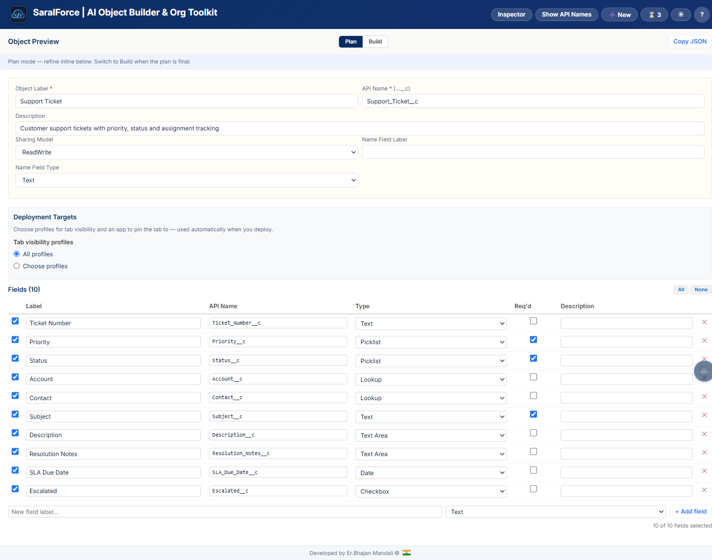
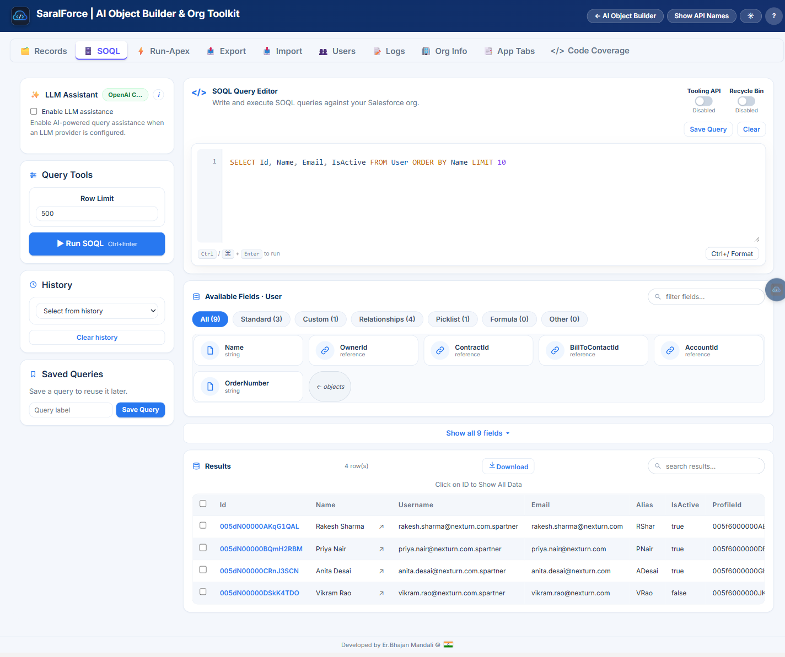
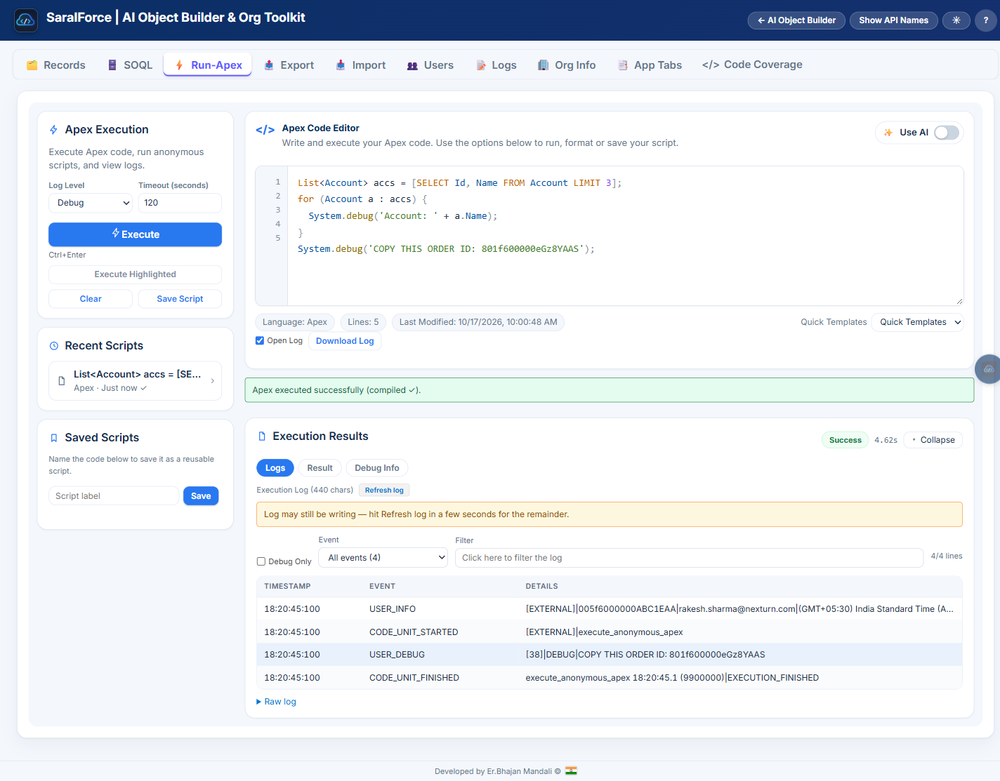
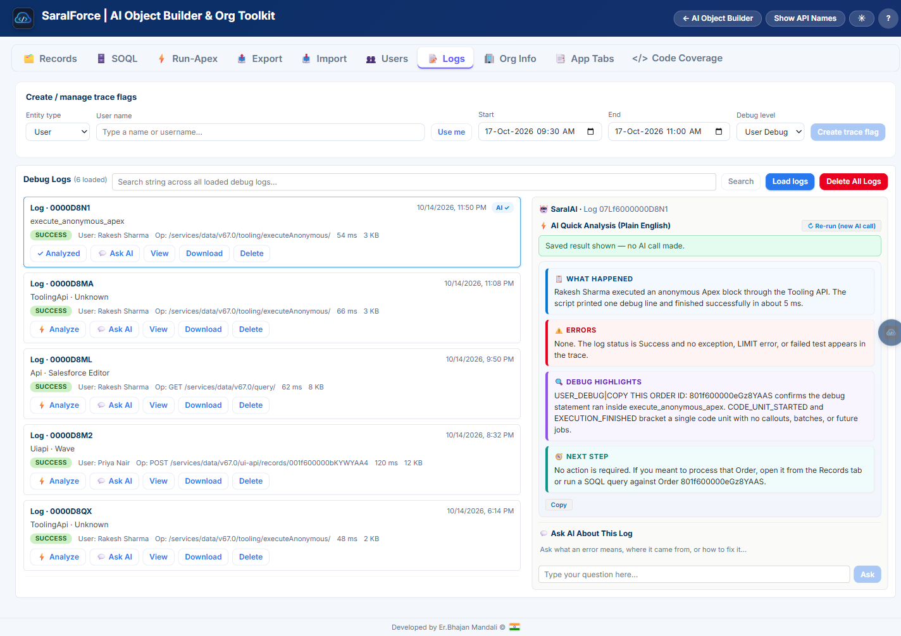
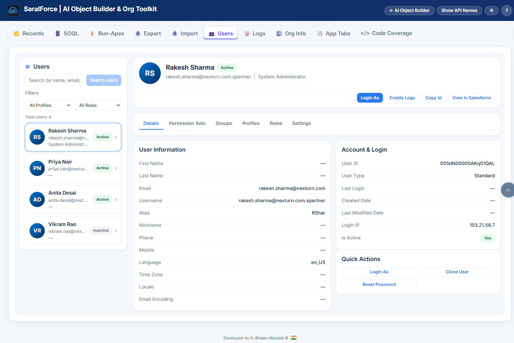

# SaralForce - AI Object Builder & Org Toolkit

A Chrome browser extension that pairs an LLM (Large Language Models) object designer with a
full Salesforce inspector — build custom objects from natural language, then run SOQL, execute
Apex, manage users, read debug logs and inspect your org without leaving the page.

Session handling builds on ideas from [Salesforce Inspector Reloaded](https://github.com/tprouvot/Salesforce-Inspector-reloaded) (MIT licensed — see `LICENSE` and `THIRD-PARTY-NOTICES.md`). SaralForce is an independent project by Bhajan Mandali and is not affiliated with, sponsored, or endorsed by Salesforce, Inc.

## Features

- **Natural Language Object Design**: Describe what data you want to capture in plain English, and the AI proposes a complete Salesforce object with fields
- **Multi-LLM Support**: Works with OpenAI, Anthropic Claude, Google Gemini, and any OpenAI-compatible API (OpenCodeZen, etc.)
- **Interactive Refinement**: Chat with the AI to modify the proposal - add fields, change types, adjust properties
- **Visual Preview (Plan / Build)**: Review the schema before deploying — labels, API names, types, required flags — then refine inline in Plan mode
- **One-Click Deploy**: Creates the custom object and all fields directly in your Salesforce org via the Tooling API, with profile tab-visibility targets
- **Relationship Fields**: AI suggests Lookup and Master-Detail relationships when appropriate
- **Field Permissions**: Configurable field-level security during deployment
- **AI Query Repair**: SOQL errors are explained and auto-fixed by the LLM with one-click apply
- **AI Log Analysis**: Debug logs get a plain-English verdict plus per-log AI chat
- **Inspector Tools**: Records browser (View / Read / Edit modes), SOQL runner, Apex executor, CSV export/import, user management with clone wizard, debug-log viewer with AI analysis, org info, app-tab assignment, code coverage

## AI Object Builder

Describe what you want in plain English and the AI proposes the complete object — labels,
API names, data types, required flags, picklist values, and Lookup/Master-Detail
relationships. Keep chatting to refine it ("add a field for resolution notes", "make
Priority required") and deploy when the visual preview looks right.

**✨ Enhance Prompt** turns a rough one-liner into a structured design brief before you
send it: business purpose, key fields and their data types, expected record volume,
relationships to standard objects, must-have vs. nice-to-have features, and security and
sharing recommendations — with **Accept** / **Discard** controls.

After the proposal arrives, the **Object Preview** opens in **Plan** mode: edit the object
label, API name, sharing model and every field inline, pick deployment-target profiles,
then switch to **Build** to lock the plan and deploy.



## Inspector Tools

Open the **Inspector** from the header (or the sidebar button) to reach every tool below.
The last opened tab and scroll position are restored the next time you open the panel.

### SOQL

A two-column workspace: LLM assistant chip, row limit, run button, query history and
saved queries on the left; the syntax-highlighted editor, colour-coded field explorer
(with category pills) and results table on the right — no horizontal scrolling.
Tooling API and Recycle Bin toggles switch the backing API per query. Click any **ID**
cell in the results to open **Show All Data** for that record.

When Salesforce rejects a query, the extension asks the LLM for a **✨ Suggested fix**:
a plain-English explanation of what went wrong plus the corrected query, with
**Apply & Run** and **Copy** buttons.



### Run Apex

Execute anonymous Apex with a terminal-style editor: line numbers, syntax highlighting,
**Quick Templates**, and saved/recent script chips. Choose the **Log Level** and
**Timeout**, then **Execute** (or Ctrl+Enter) — or select a snippet and **Execute
Highlighted**. Toggle **Use AI** to pre-check code before each run; compile errors get a
suggested fix you can apply in one click. After a run, the **Execution Results** panel
shows the debug log with event filters, a Debug-Only view, and the raw trace.



### Debug Logs

- Load recent `ApexLog` rows for any user or Apex class in a chosen time window, with
  trace-flag management built in.
- **⚡ AI Quick Analysis (Plain English)** — a one-click verdict per log rendered as four
  cards: *What happened*, *Errors*, *Debug highlights*, *Next step*. Results are cached
  per log ID, so clicking **Analyzed** again shows the saved result without another AI
  call; **Re-run** forces a fresh call when you want one.
- **💬 Ask AI** — a per-log chat for drilling into any line of the trace.
- Search across every loaded log body, view/download individual logs, or delete them
  (single or bulk) straight from the panel.



### Users

Search and filter the org's users by profile or role, then select one to inspect:
full detail tabs (**Details**, **Permission Sets**, **Groups**, **Profiles**, **Roles**,
**Settings**), recent **Login IP** addresses, and quick actions — **Login As**, **Enable
Logs** (30-minute debug trace), **Copy Id**, and **View in Salesforce**. Community users
get an **Experience-site login** picker when live sites exist.

**Clone User** walks through a two-step wizard — pick the source user and the components
to copy (permission sets, groups, role), review the summary, then create the new user
and its assignments. **Reset Password** sends the standard Salesforce password-reset
email via the User password API.



### Records, Export & Import

- **Records** — open any record in View, Read-only or Edit mode with a field summary,
  related-record lookups, Show-All-Data popup, and CSV export of the current layout.
- **Export / Import** — query any object and download CSV, or upload a CSV to create or
  update records with field mapping.

### Org Info, App Tabs & Code Coverage

- **Org Info** — org identity, storage and API limits, recent setup-audit events and
  login history; an optional AI hygiene audit summarises what to fix first.
- **App Tabs** — assign custom tabs to console applications so new objects show up where
  your users work.
- **Code Coverage** — per-class coverage from `ApexCodeCoverageAggregate`, test-class
  filtering, and a one-click test run with freshness polling.

## Installation

### Prerequisites

- Google Chrome browser (v88 or later)
- Node.js with npm (for React dependencies)
- A Salesforce org where you have System Administrator permissions
- An API key from at least one LLM provider

### Setup

1. **Clone or download this repository**

2. **Install dependencies** (to get React):
   ```bash
   cd sf-object-creator
   npm install
   npm run copy-react
   ```

3. **Load the extension in Chrome**:
   - Open `chrome://extensions/`
   - Enable **Developer mode** (toggle in top right)
   - Click **Load unpacked**
   - Select the `addon` subdirectory of this project

4. **Configure your LLM provider**:
   - Click the extension icon on any Salesforce page
   - Click **Options** (or open `options.html` from the extension)
   - Select your LLM provider (OpenAI, Claude, Gemini, or OpenAI-compatible)
   - Enter your API key
   - Select a model
   - Click **Save Settings** then **Test Connection**

5. **Start creating objects**:
   - Navigate to your Salesforce org
   - Click the extension icon
   - Click **SaralForce** sidebar button
   - Describe the object you want to create!

## Usage Examples

### Example 1: Payment Transactions
```
I want an object that captures payment transaction data including amount, status, payment method, and reference numbers
```

**AI Output**: Creates a `Payment_Transaction__c` object with fields:
- Amount (Currency)
- Status (Picklist: Pending, Completed, Failed, Refunded)
- Payment Method (Picklist: Credit Card, Debit Card, Bank Transfer, PayPal, Other)
- Reference Number (Text, External ID)
- Transaction Date (DateTime)

### Example 2: Support Tickets with Relationships
```
Create a customer support ticket object that relates to Accounts and Contacts, with priority levels and assignment tracking
```

**AI Output**: Creates a `Support_Ticket__c` object with Lookup fields to Account and Contact, plus Priority picklist, Status picklist, and assignment fields.

### Example 3: Refinement
After the initial proposal, you can say:
```
Add a field for the resolution notes and make the priority field required
```

The AI will update the proposal accordingly.

## Supported Field Types

| Type | Description |
|------|-------------|
| Text | Short text (up to 255 chars) |
| Text Area | Multi-line text |
| Text Area (Long) | Very long text content |
| Number | Numeric values |
| Currency | Monetary amounts |
| Percent | Percentage values |
| Date | Date only |
| Date/Time | Date and time |
| Checkbox | Boolean true/false |
| Picklist | Single select from values |
| Picklist (Multi-Select) | Multiple select from values |
| Email | Email addresses |
| Phone | Phone numbers |
| URL | Web links |
| Lookup | Relationship to another object |
| Master-Detail | Required relationship to another object |

## LLM Provider Configuration

OpenAI, Anthropic Claude, Google Gemini, OpenRouter, and any OpenAI-compatible endpoint
(OpenCodeZen, etc.) are supported. One configuration drives every AI feature —
the object-builder chat, Enhance Prompt, SOQL query repair, Apex pre-check, and
debug-log analysis.

- **API Key**: your provider's key (stored only in your browser's local storage)
- **Base URL**: only needed for OpenAI-compatible endpoints
- **Models**: the Options page always lists the currently supported models

## What's New

### v1.4.20
- **OpenRouter provider** — pick OpenRouter in Settings with its own API-key/base-URL
  placeholders and vendor/model ID guidance; shares the OpenAI-compatible adapter
- SOQL LLM chip no longer overlaps the editor title in light theme
- README refreshed with current screenshots for Object Builder, SOQL, Run Apex,
  Debug Logs and Users

### v1.4.19
- **Users tab rebuilt** — auto-loaded user list with profile/role filters, full detail
  tabs (Permission Sets, Groups, Profiles, Roles, Settings), recent Login IP, **Reset
  Password**, and a two-step **Clone User** wizard (select components → review → create)
- **Run-Apex polish** — compact Log Level / Timeout controls, iOS-style **Use AI**
  pre-check switch, Execute + Execute Highlighted moved to the sidebar, header trimmed
- **SOQL quality-of-life** — click any result ID to Show All Data, plain `N row(s)`
  counts, light-theme legibility fixes across the panel

### v1.4.17
- **Records** rewritten with View / Read-only / Edit modes and summary header
- **SOQL M3** two-column redesign with field explorer, Tooling API and Recycle Bin
  toggles, and terminal-style field tools
- CloudFlow light theme with Inter typography across the inspector
- Gemini model lineup refresh; last-page restore with a reload guard

### v1.4.15
- Inspector-in-new-tab option, Show All Data button, full Apex log viewer
- Code Coverage tab, Experience-site login fix, aggregate LIMIT guard
- Editor success celebrations (plane / confetti / thor / spidey)

## Architecture

```
sf-object-creator/
├── addon/
│   ├── manifest.json          # Chrome Extension Manifest V3
│   ├── background.js          # Service worker (session + LLM proxy)
│   ├── inspector.js           # Salesforce API layer (REST/SOAP)
│   ├── inspector-tools.js     # Inspector tabs (Records, SOQL, Run-Apex, Users, Logs, …)
│   ├── object-creator.html/js # Main feature page (chat, preview, inspector shell)
│   ├── options.html/js        # LLM provider settings
│   ├── button.js/css          # Content script (injected into SF pages)
│   ├── sf-time.js             # Shared time-zone helpers
│   ├── llm/
│   │   ├── llm-service.js     # Provider abstraction + config
│   │   ├── openai.js          # OpenAI adapter
│   │   ├── claude.js          # Anthropic Claude adapter
│   │   ├── gemini.js          # Google Gemini adapter
│   │   └── openai-compatible.js
│   ├── prompts/
│   │   └── system-prompt.js   # AI prompt engineering
│   └── styles/slds/           # Salesforce Lightning Design System CSS
└── package.json
```

## Security

- API keys are stored locally in your browser (`localStorage`) and never sent anywhere except the LLM provider you configured
- The extension communicates directly with Salesforce APIs using your existing session
- Only your natural language descriptions are sent to LLM providers - object/field data stays in your org unless you paste it into the chat
- Same authentication model as Salesforce Inspector Reloaded (OAuth2 PKCE + session cookies)

## Permissions

- `cookies`: Read Salesforce session cookies for API authentication
- `storage`: Store LLM configuration and extension settings
- Host permissions for Salesforce domains and LLM API endpoints

## Development

```bash
# Install dependencies
npm install

# Copy React files to addon directory
npm run copy-react

# Load in Chrome
# 1. Open chrome://extensions/
# 2. Enable Developer mode
# 3. Click Load unpacked
# 4. Select the addon/ directory
```

## License

MIT License — see `LICENSE`. Session/auth code derives in part from
Salesforce-Inspector-reloaded (MIT © 2023 Thomas Prouvot); see
`THIRD-PARTY-NOTICES.md` for full attribution.
