# SaralForce | Build, Inspect & Deploy Salesforce

**Admin & Developer Toolkit**

<p align="center">
  <a href="https://chromewebstore.google.com/detail/saralforce/fgapgjgejookdgliokajnbfkabkifclg"></a>
  <a href="https://microsoftedge.microsoft.com/addons/detail/saralforce/nabomjoibaaoialocfpphgcmfldjmeik"></a>
</p>

**SaralForce | Build, Inspect & Deploy Salesforce** is a free browser extension for Google
Chrome and Microsoft Edge that puts a full Salesforce toolkit in a side panel on every
Salesforce page. Design custom objects from plain English and deploy them; inspect and edit
records; run SOQL and anonymous Apex; export and import data; profile debug logs; check user
access and compare profiles across orgs; read, create and change metadata; onboard to an
unfamiliar org with the Org Handbook; and move changes between orgs with SandShift, its
release center, with rollback. AI helpers are optional: every core tool works with just your
Salesforce login.

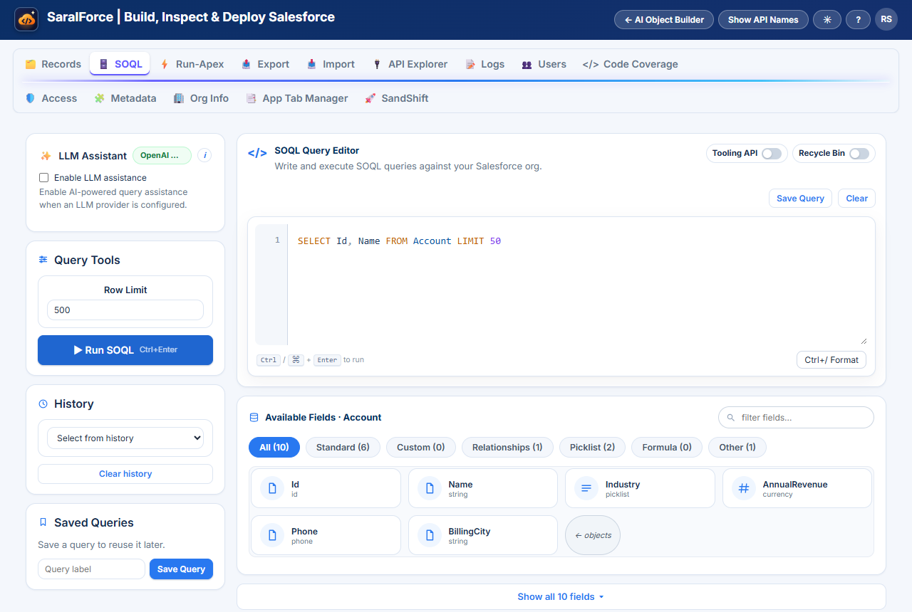

## What's inside

| Area | In one line |
|---|---|
| [Getting around](#getting-around) | Movable launcher, two-row tool bar, tours, themes, and the panel remembers your place. |
| [AI Object Builder](#ai-object-builder-) | Describe an object in plain English, refine the plan, deploy it with field access and a tab. |
| [Records](#records) | The record you are looking at: edit in place, related records, field history. |
| [SOQL](#soql) | Editor with autocomplete, field explorer, paging past 20,000 rows, and AI write, explain and fix. |
| [Run Apex](#run-apex) | Anonymous Apex with its own debug log, governor limit bars and an AI pre-check. |
| [Export](#export) | Query builder with preview, Data API or Bulk API 2.0, and CSV, Excel or JSON output. |
| [Import](#import) | Insert, update, upsert or delete from CSV with mapping templates, validation and result files. |
| [Logs](#logs) | Trace flags, log search, AI analysis and a ⏱ profiler with hot spots and a timeline. |
| [API Explorer](#api-explorer) | Call any REST, Composite, Tooling or SOAP API with your session. |
| [Code Coverage](#code-coverage) | Coverage per class, covered and uncovered lines, test runs and AI failure explanations. |
| [Users](#users) | Find, inspect and change users, and answer "why can this user see it?" with Access Check. |
| [Access](#access) | Compare profiles, users and roles across orgs, sharing settings, risky access and approvals. |
| [Metadata](#metadata) | Read, explain, create and deploy Apex, LWC, Aura, flows, rules and custom metadata, plus the Org Handbook. |
| [Org Info](#org-info) | Limits, audit trail, jobs, logins and an AI hygiene audit. |
| [App Tab Manager](#app-tab-manager) | Put tabs into Lightning apps and control who can see them. |
| [SandShift](#sandshift-release-center) | Compare orgs, package, validate, deploy, roll back, check impact, use GitHub, and manage sandboxes. |
| [Settings & AI providers](#settings--ai-providers) | Free (test), OpenAI, Claude, Gemini, OpenRouter or any OpenAI-compatible endpoint, with AI usage. |
| [Safety, privacy and limits](#safety-privacy-and-limits) | What SaralForce never does without asking, and what stays in your browser. |

> **Full feature guide:** [docs/FEATURES.md](docs/FEATURES.md) lists every tool, what it can
> view and change, and where the limits are.

## FAQ

**What is SaralForce?**
SaralForce is a free Salesforce inspector and admin and developer toolkit for Google Chrome
and Microsoft Edge. A side panel on every Salesforce page gives you an AI object builder,
records, SOQL, Apex, data export and import, debug logs with a profiler, an API explorer,
code coverage, user and access tools, a metadata workbench with the Org Handbook, org info,
an app tab manager and SandShift, a release center for moving changes between orgs.

**How is SaralForce different from other Salesforce inspector tools?**
It covers the classic inspector workflows (SOQL, data export, record lookup, users) and goes
further: deploy between orgs with validation, rollback and impact analysis; compare profiles,
users and sharing settings across orgs; build objects, LWCs and Apex from plain English; and
explain flows, logs and failures in plain words.

**Is SaralForce free? Does it send my data anywhere?**
The extension is free. There are no accounts, analytics or tracking, and no SaralForce server:
the panel talks to Salesforce directly with your own session. Org data goes to an AI provider
only when you press an ✨ button, and only to the provider you picked.

**Do I need an AI API key to use it?**
No. Everything except the ✨ features works with just your Salesforce login. To try the ✨
features without a key, pick the **Free (test)** provider in Settings.

**What is the Free (test) AI provider?**
A no-key option for testing only. Requests go to free public OpenAI-compatible endpoints,
**LLM7**, then **Pollinations**, then **Cehpoint**, and move to the next one automatically when
one errors, times out or hits its rate limit. These are third-party services, so prompts
(SOQL, metadata, log excerpts) go to them. Use your own key for real org data.

**Which AI providers are supported?**
Free (test), OpenAI, Anthropic Claude, Google Gemini, OpenRouter, and any OpenAI-compatible
endpoint. Your key is stored only in the extension's own storage.

**Which browsers are supported?**
Google Chrome ([Chrome Web Store](https://chromewebstore.google.com/detail/saralforce/fgapgjgejookdgliokajnbfkabkifclg))
and Microsoft Edge ([Edge Add-ons](https://microsoftedge.microsoft.com/addons/detail/saralforce/nabomjoibaaoialocfpphgcmfldjmeik)).
Developers can also load the `addon` folder as an unpacked extension.

## Features

Legend: 👁 read-only · ✏️ changes the org · ✨ uses AI · 🔒 asks for confirmation first.

### Getting around

- **Launcher button** on every Salesforce page opens the panel. Drag it anywhere if it covers
  something: it stays there on every Salesforce tab, and right-click puts it back on the right edge.
- **Two-row tool bar**: data and code tools on top, admin tools below; nothing scrolls sideways.
- **Header**: switch between AI Object Builder and Inspector, Show / Hide API Names on the record
  page, Theme (System, Light, Dark) and the **?** menu with tours, What's new, AI usage and Help.
- **Remembers your place**: last tool, queries, filters and results survive closing the panel;
  messages and progress bars scroll into view when they appear.

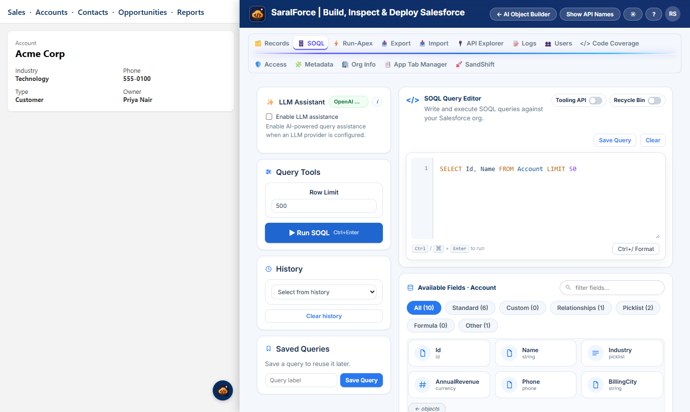

Details → [docs/FEATURES.md#1-getting-around](docs/FEATURES.md#1-getting-around)

### AI Object Builder ✨

- **Describe an object** in plain English; the AI proposes label, API name, fields, types,
  picklist values and Lookup / Master-Detail relationships. ✨ **Enhance Prompt** turns a
  one-liner into a full design brief.
- **Plan mode**: edit everything inline, open **⚙** field details (formulas, roll-ups,
  dependent picklists with a matrix, auto numbers, history tracking), add validation rules,
  list views and a compact layout, or ✨ **Ask AI** to change the plan. Undo / Redo every change.
- **23 field types**, including Formula, Roll-Up Summary, Auto Number, Geolocation, Time,
  rich text and encrypted text.
- **Field access** for your profile, the tab visibility profiles or a new permission set;
  **Show in app** adds the tab to a Lightning app.
- **✎ Edit an existing object**: add fields and rules, and edit labels, help text, lengths and
  picklist values of existing fields.
- **Build mode** deploys the object, fields, layouts, rules and tab, then checks and repairs
  your access so the tab shows in the App Launcher.

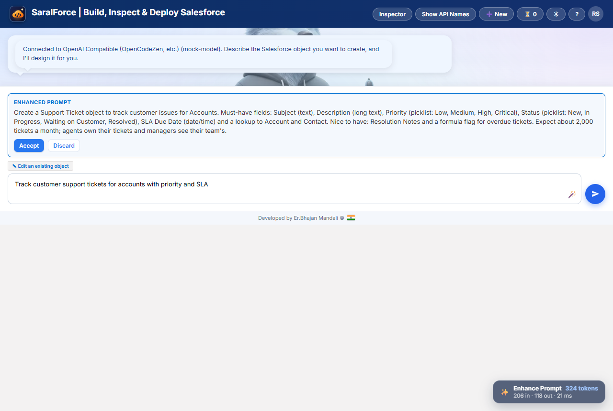

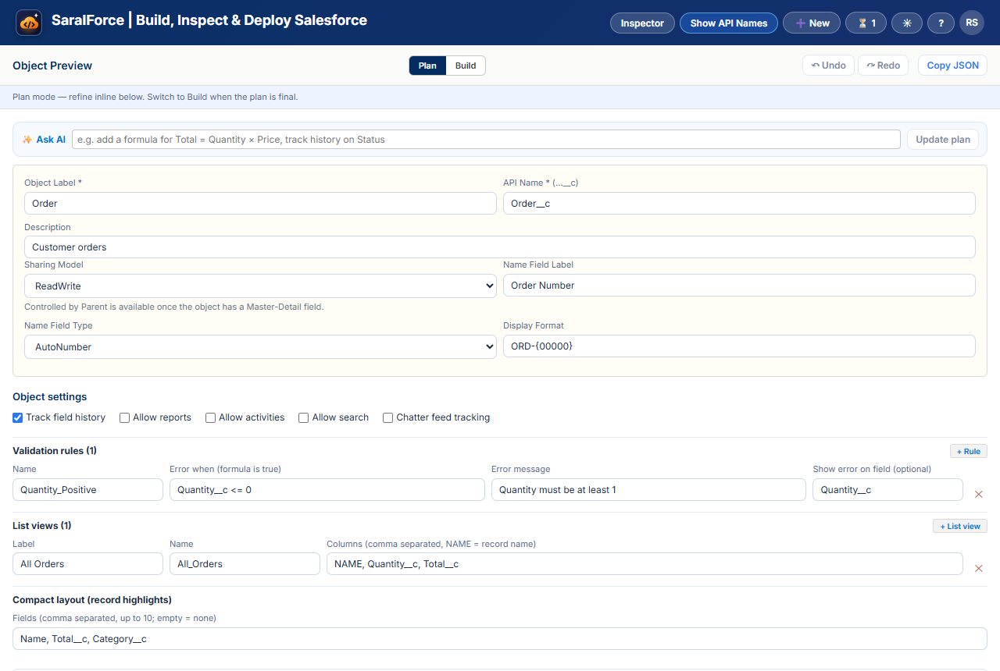

Details → [docs/FEATURES.md#2-ai-object-builder-](docs/FEATURES.md#2-ai-object-builder-)

### Records

- 👁 **Detects the record** on the current Salesforce page; **↻ Reload page** follows you when
  you move to another record. **Load Object** opens any object by API name.
- ✏️ **Edit fields in place**, or in **Show All Data** with every field, layout or not.
- 👁 **Related**: parents and every child list with counts; click through and come back
  along the trail. 👁 **History** shows field changes as a timeline.
- **Tooling API** toggle for setup records; export the record as CSV; open it in Salesforce.

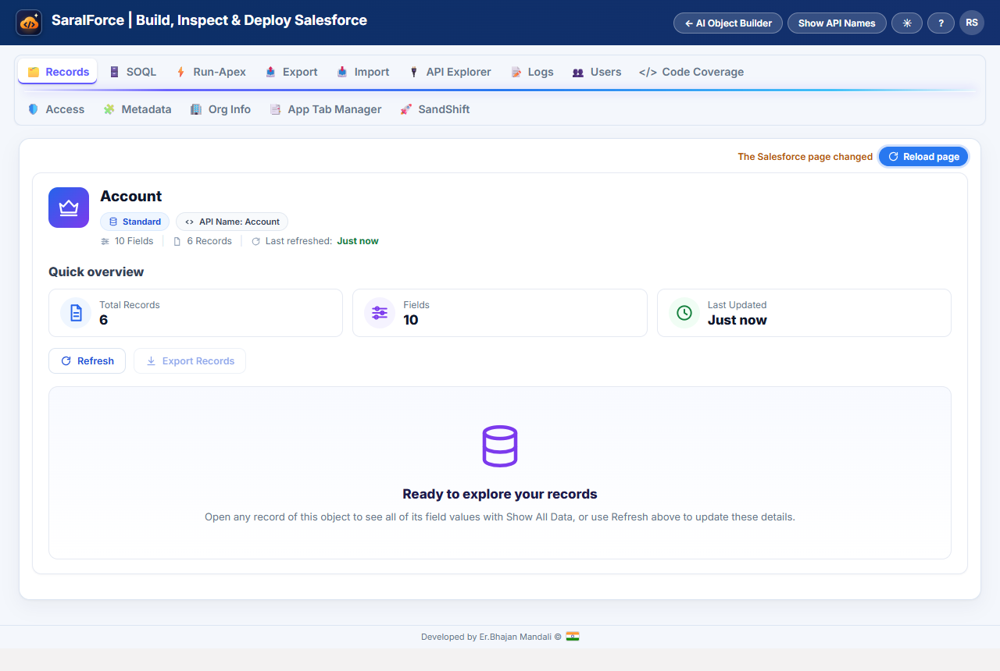

Details → [docs/FEATURES.md#3-records](docs/FEATURES.md#3-records)

### SOQL

- **Editor** with highlighting, line numbers, Ctrl+Enter to run and Ctrl+/ to format.
- **Autocomplete** for objects, fields, relationship paths up to 5 levels, sub-queries,
  `FIELDS(ALL)` and keywords; a **field explorer** inserts fields with a click.
- **Results** with sorting, search and CSV download; 300 rows a page, and **Fetch more rows**
  past 20,000. Tooling API and Recycle Bin toggles; history and saved queries.
- ✨ **Write SOQL** from plain English with your org's real fields, ✨ **Explain** a query, and
  ✨ **Suggested fix** with **Apply & Run** when a query fails.

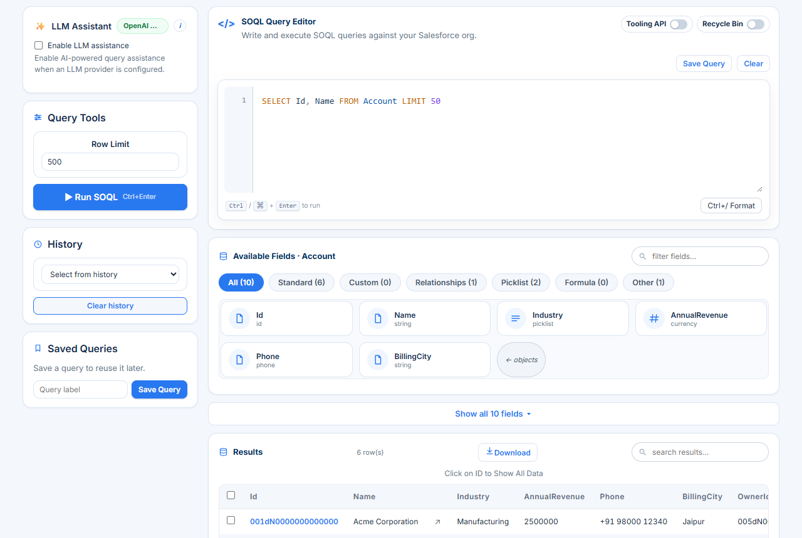


Details → [docs/FEATURES.md#4-soql](docs/FEATURES.md#4-soql)

### Run Apex

- ✏️ **Execute anonymous Apex** or only the highlighted lines; error line numbers point at the
  right place, with **Go to line N**.
- **One call, exact log**: each run gets its own debug log back, with no trace flag.
- **Limits** shows CPU, SOQL, DML and heap used as bars; quick templates, saved and recent scripts.
- ✨ **Use AI** checks for compile errors before running and offers a fix or **Run anyway**.

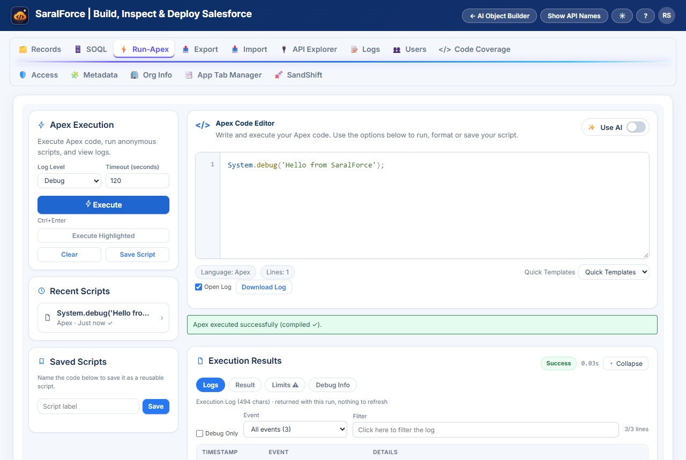

Details → [docs/FEATURES.md#5-run-apex](docs/FEATURES.md#5-run-apex)

### Export

- **Build the query** with an object picker, field explorer, autocomplete, Validate and Format.
- **Preview** real results with sorting and "load more from server".
- **Data API** or **Bulk API 2.0** for very large exports, with job tracking and Cancel Job.
- **CSV, Excel or JSON** with delimiter, line ending, encoding, quoting and date options;
  cells starting with `= + - @` are made spreadsheet-safe. Saved exports and history per org.

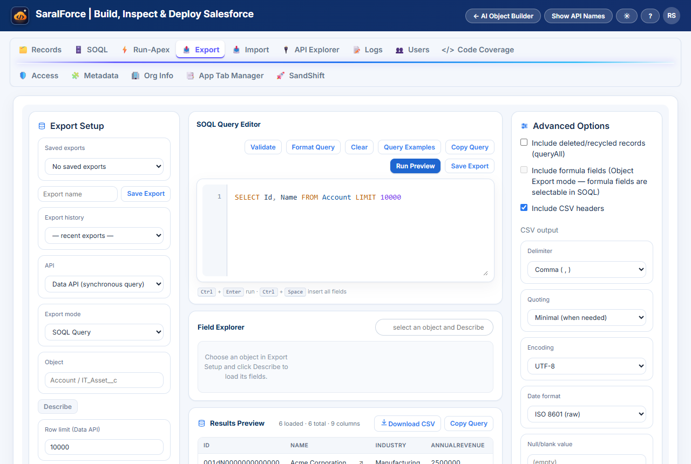

Details → [docs/FEATURES.md#6-export](docs/FEATURES.md#6-export)

### Import

- ✏️ **Insert, Update, Upsert, Delete** 🔒 from a dropped, chosen or pasted CSV.
- **Field mapping** with suggestions, saveable templates and External IDs for upserts.
- **Validate Data** before sending, with an error CSV, and an optional duplicate check.
- **Data API** (200 records per call, live progress, Stop) or **Bulk API 2.0** (live job
  tracking, Cancel Job); success, failed and unprocessed result files from Salesforce.

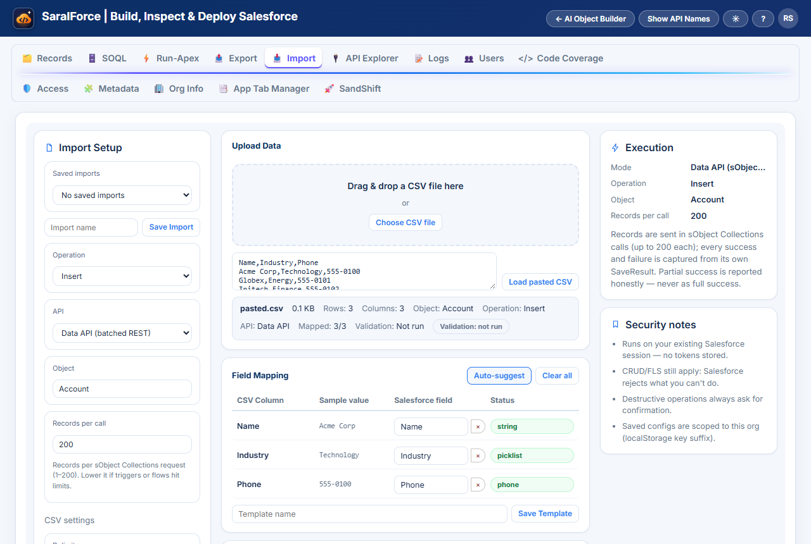

Details → [docs/FEATURES.md#7-import](docs/FEATURES.md#7-import)

### Logs

- ✏️ **Trace flags** for a user or an Apex class; 👁 load, search, view and download logs;
  ✏️ delete one or all 🔒.
- ✨ **AI Quick Analysis**: what happened, errors, debug highlights and next step, cached per log.
  ✨ **Ask AI About This Log** opens a chat about one log.

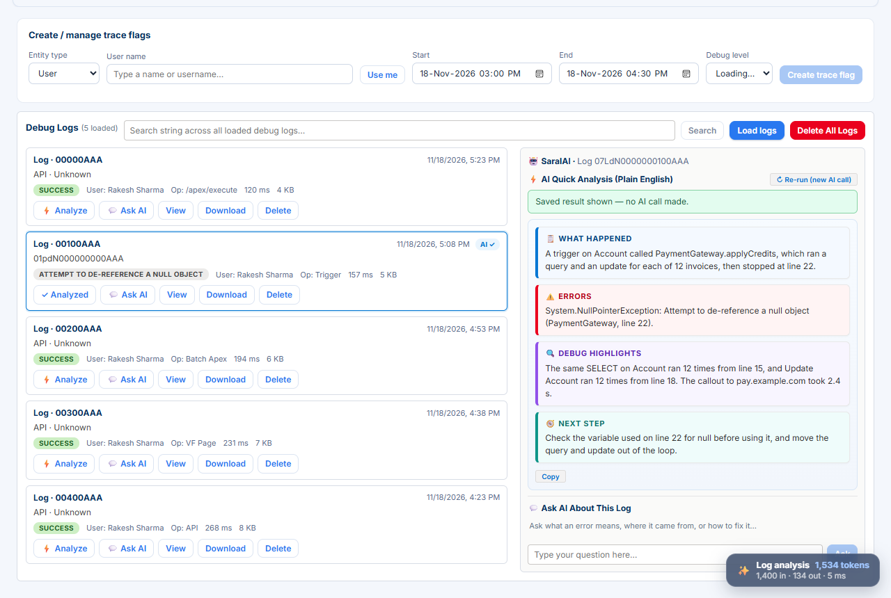

#### ⏱ Profile a log ✨

- Switch a log from **Lines** to **⏱ Profile** for a summary (time, CPU, SOQL, DML, callouts).
- **Hot spots**: queries and DML in loops, very large queries, slow callouts, limits over 70%.
- **Timeline** of code units, methods, queries and callouts; slowest methods; query, DML and
  callout tables.
- ✨ **How to speed this up** sends only the summary, never the raw log. Needs Apex Code at
  FINE or Apex Profiling at INFO.

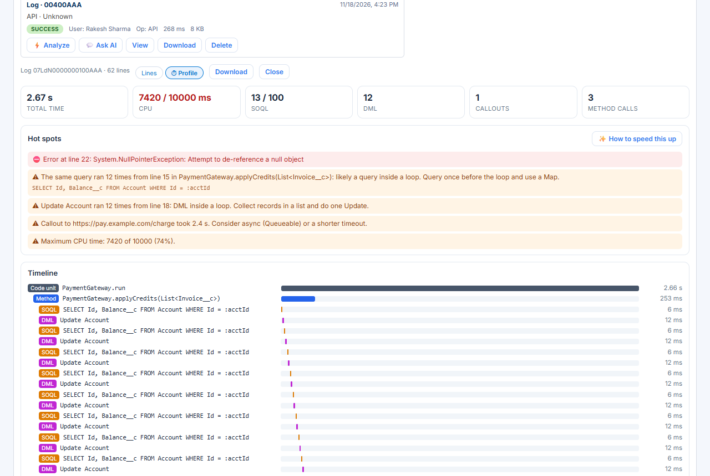

Details → [docs/FEATURES.md#8-logs-debug-logs](docs/FEATURES.md#8-logs-debug-logs) ·
[docs/FEATURES.md#81-profile-a-log--](docs/FEATURES.md#81-profile-a-log--)

### API Explorer

- 👁 / ✏️ **REST and Composite**: GET, POST, PATCH, PUT and DELETE 🔒 to any path, with presets
  for org, data, Tooling and Apex REST calls.
- **SOAP**: Partner, Metadata and Apex APIs with a ready envelope.
- **Response** with status, time, size, headers and body; paths in JSON are links. History of
  the last 30 calls per org.

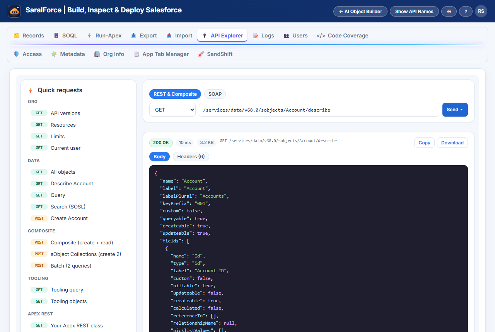

Details → [docs/FEATURES.md#9-api-explorer](docs/FEATURES.md#9-api-explorer)

### Code Coverage

- 👁 **Coverage per class and trigger** with search and a test-class filter.
- 👁 **Lines**: covered lines green, uncovered red, and **First uncovered line**.
- ✏️ **Run tests**: all or one class, live progress, **Abort** 🔒, results per method with
  messages and stack traces.
- ✨ **Explain failure**: why a test failed and how to fix it.

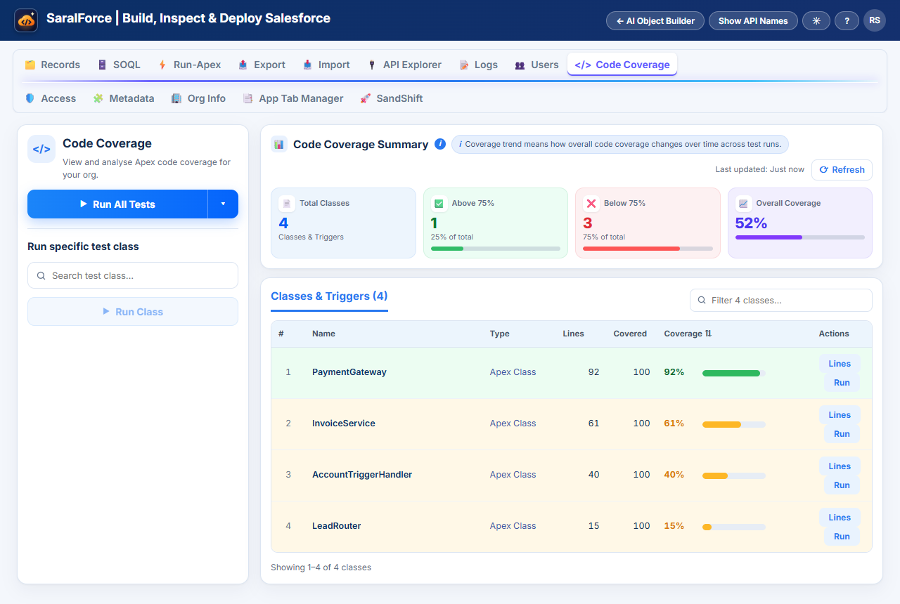

Details → [docs/FEATURES.md#10-code-coverage](docs/FEATURES.md#10-code-coverage)

### Users

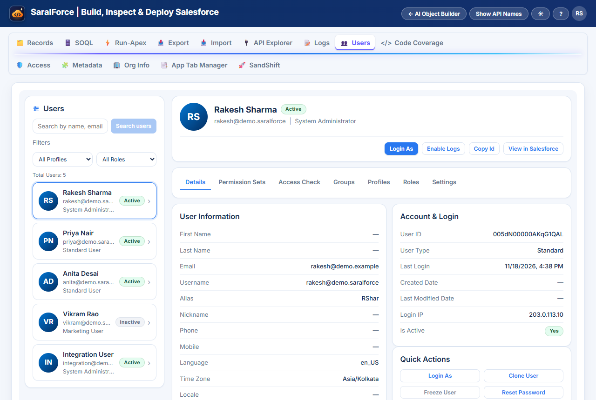

#### Find users

- **Live search** by name, username, email or alias, across the whole org; filter by profile and role.

#### Inspect a user 👁

- Sub-tabs: **Details** (login IP, active, frozen), **Permission Sets** (sets and groups),
  **Access Check**, **Groups**, **Profiles** / **Roles** and **Settings**.

#### Change a user ✏️

- **Assign** or **remove** 🔒 permission sets and permission set groups.
- **Login As**, Experience Site login, **Freeze / Unfreeze** 🔒, **Reset Password** 🔒,
  **Enable Logs** (30 minutes) and a **Clone User** wizard.

#### Access Check 👁

- Answers "why can this user see it?" for an **object**, a **field** or a **system permission**:
  the effective result and every profile, permission set or group that grants it.

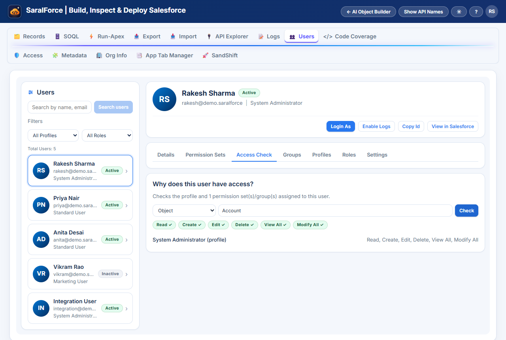

Details → [docs/FEATURES.md#11-users](docs/FEATURES.md#11-users)

### Access

A menu at the top: **Compare · Sharing settings · Risky access · Approvals**.

#### Compare 👁

- Two sides, each in its own org (any org you're logged into): **profiles & permission sets**,
  **users** (effective access, with where it comes from) or **roles & groups**.
- Sections for system, object and field permissions, tabs, apps, Apex and Visualforce access,
  custom permissions, flows, sharing rules and sharing defaults; **Only differences** on by default.
- **What differs** in plain words, **＋ Same as left** to match items across orgs, Download CSV.

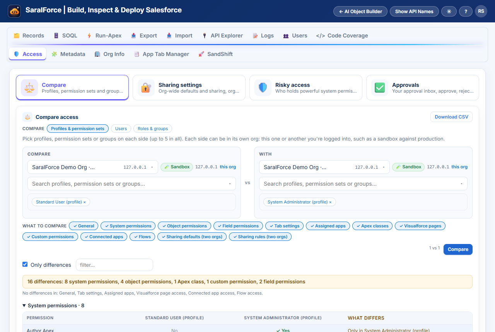

#### Sharing settings 👁

- Setup's Sharing Settings page in two orgs side by side: org-wide defaults, other settings,
  sharing rules, sharing sets and restriction and scoping rules, object by object.

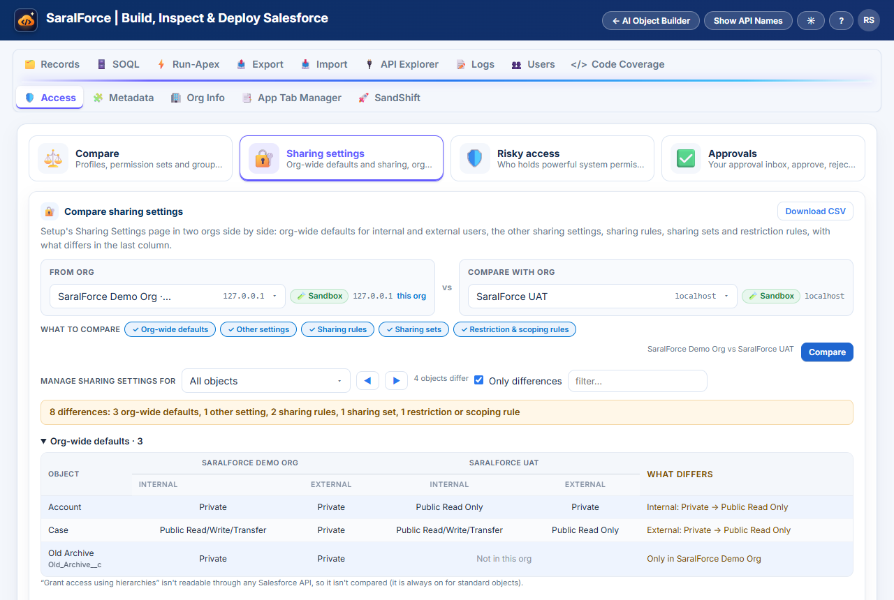

#### Risky access 👁 ✨

- Active users holding powerful permissions (Modify All Data, Author Apex, Manage Users…),
  per permission and per user, with ✨ **Summarize with AI**.

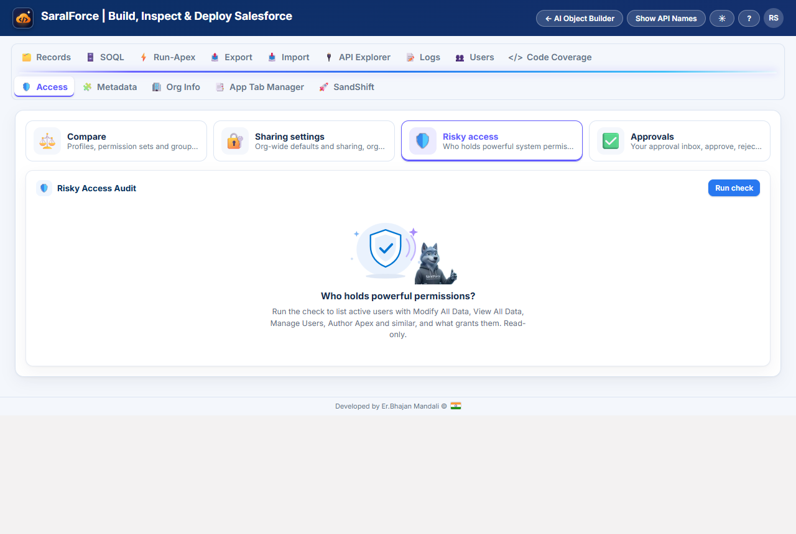

#### Approvals ✏️

- Your inbox (direct and through queues), all pending requests in the org and what you
  submitted; **Approve / Reject** 🔒 with a comment, and submit a record for approval.

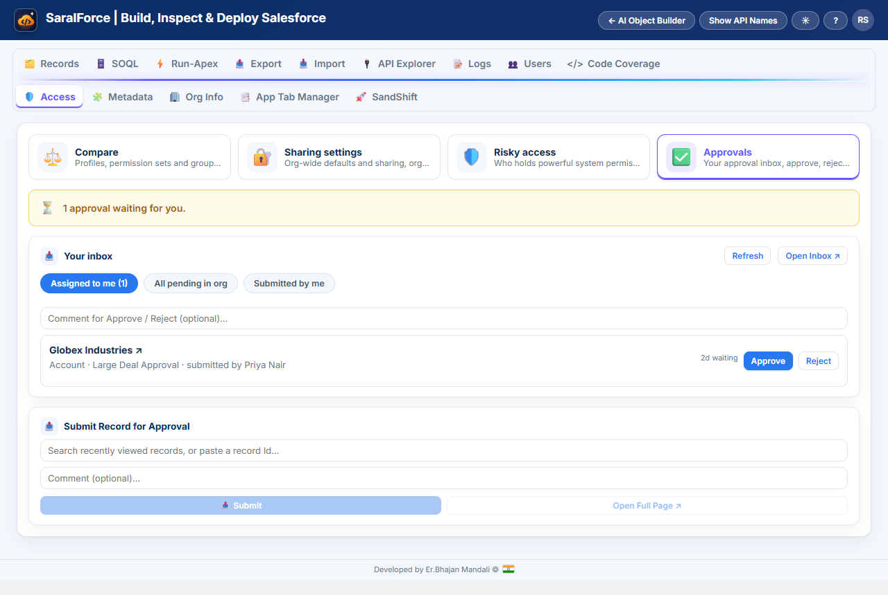

Details → [docs/FEATURES.md#12-access](docs/FEATURES.md#12-access)

### Metadata

Pick a kind from the chips at the top (each shows a count); **＋ New …** creates one.

#### Common to every kind

- **Overview** built from the source, **Source** with line numbers, ✨ **Explain** in plain words,
  **Open in Setup ↗**, **＋ package.xml**, copy source, and **⛶ Full screen** in its own tab.

#### Apex, triggers, Visualforce, LWC, Aura and flows 👁

- **Apex classes**: sharing mode, annotations, SOQL / DML / callout counters and a method table
  that jumps to the line.
- **Triggers**: the object, which of the 7 events it runs on and the handler classes it calls.
- **Visualforce pages**: controller and extensions, render-as, components and merge fields.
- **LWC** and **Aura**: where it can be used, public properties or attributes, Apex and wire
  calls, child components and a **Bundle** file tree.
- **Flows**: what starts it, then every step in order with where each decision branch goes;
  versions, outline and raw metadata.

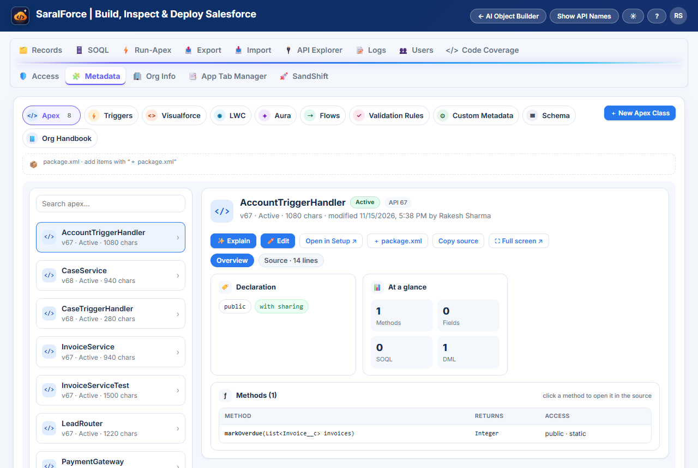

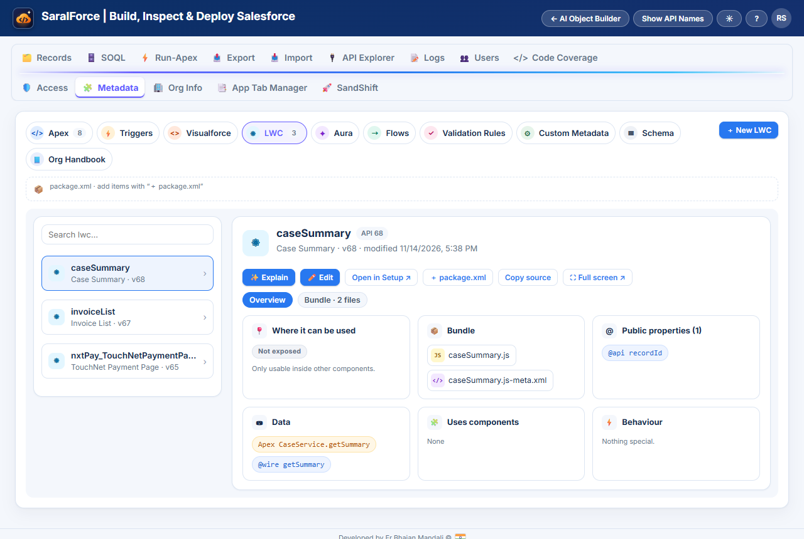

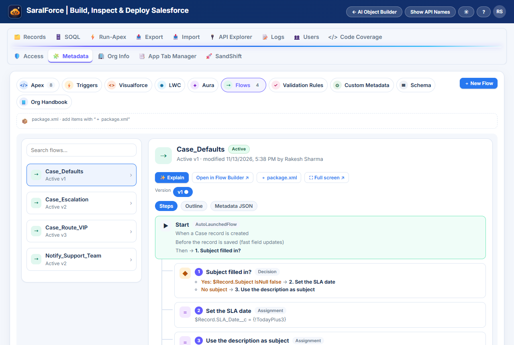

#### Validation rules ✏️ ✨

- Highlighted formula with its fields and functions, and a preview of the error the user sees.
- **Active** switch, **Edit rule**, and ✨ **Use AI** to write the formula, message and error field.

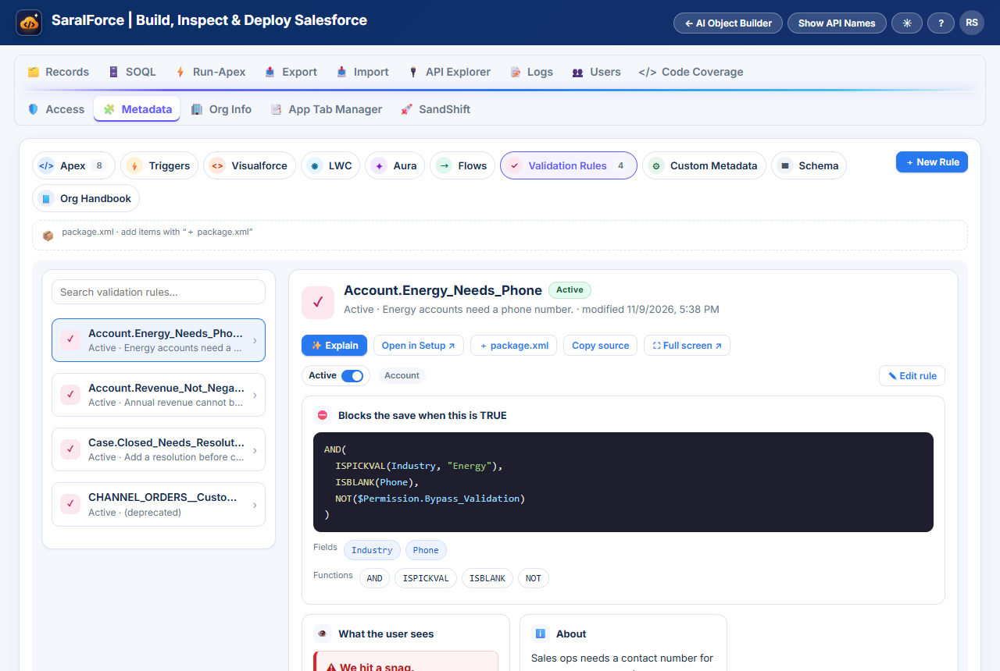

#### Custom Metadata Types ✏️

- Every `__mdt` type with all records and field values; **✎ Edit records** in a grid and save
  them together; new and delete 🔒 records; **＋ New Metadata Type** with fields; CSV download.

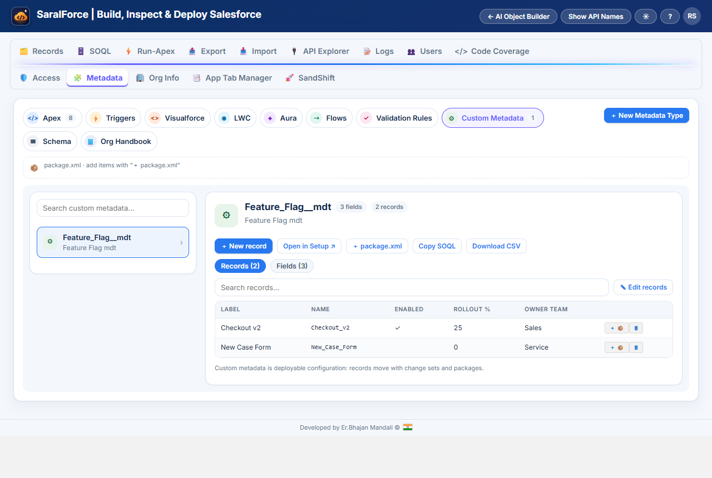

#### Schema and Data quality 👁

- Fields table with types, formulas and picklist values; per-field **Access** and **Where used**;
  a **Relationships** diagram; schema JSON download.
- **Data quality** profiles a record sample: fill rate, common values, inactive picklist values,
  likely duplicates and a quality score, with ✨ **AI review**.

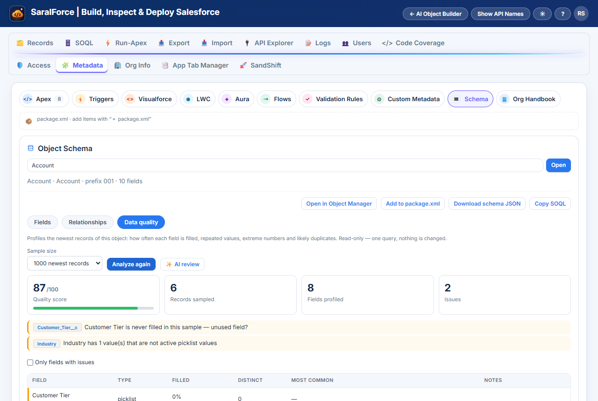

#### ＋ New ✏️ ✨

- Create Apex classes (9 templates), triggers with a handler, Visualforce pages, **LWC** (5
  templates), Aura, flows, validation rules and custom metadata types, or ✨ **Build with AI**.
- The **draft editor** keeps drafts in this browser; a known-mistake check, **Check compile**,
  ✨ **Ask AI to change** and ✨ **Fix with AI**, then **✓ Deploy** as one all-or-nothing package.

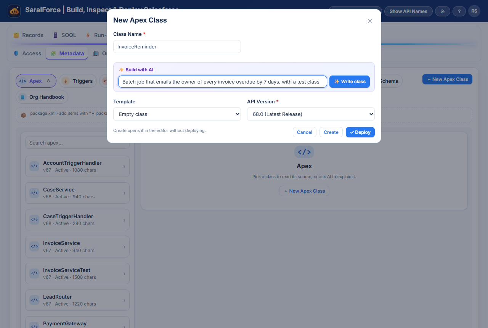

#### package.xml basket

- **＋ package.xml** on any class, trigger, page, component, flow, rule, object or custom
  metadata record; **Download package.xml** (sorted, de-duplicated) or Clear.

#### Org Handbook 👁 ✨

- For someone who just joined: **My onboarding** checklist, how the business works, a day-one
  reading order, departments, business processes and a glossary.
- **Flows**: every active flow in plain words, with a simple diagram and the story step by step;
  ✨ **Explain all flows simply**.
- **Business processes**: the life of a record across its stages, who works on it and what they
  see on its page. 💬 **Ask the org** in plain words; 🆕 **What's new** in the last days or since you joined.
- **Technical map** for developers; kept in this browser per org; download as **HTML** or
  **Markdown** with Mermaid diagrams.

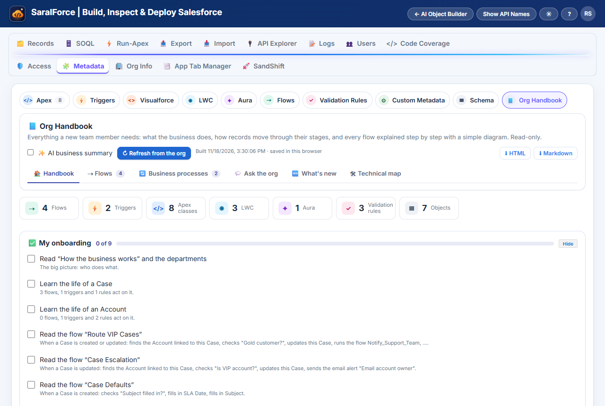

Details → [docs/FEATURES.md#13-metadata](docs/FEATURES.md#13-metadata) ·
[Org Handbook](docs/FEATURES.md#1313-org-handbook--)

### Org Info

- 👁 Organization details, storage and API limits as bars, permission set counts.
- 👁 Setup Audit Trail (newest 200), Apex jobs and login history.
- ✨ **AI Org Hygiene Audit**: risks and next steps from read-only facts.

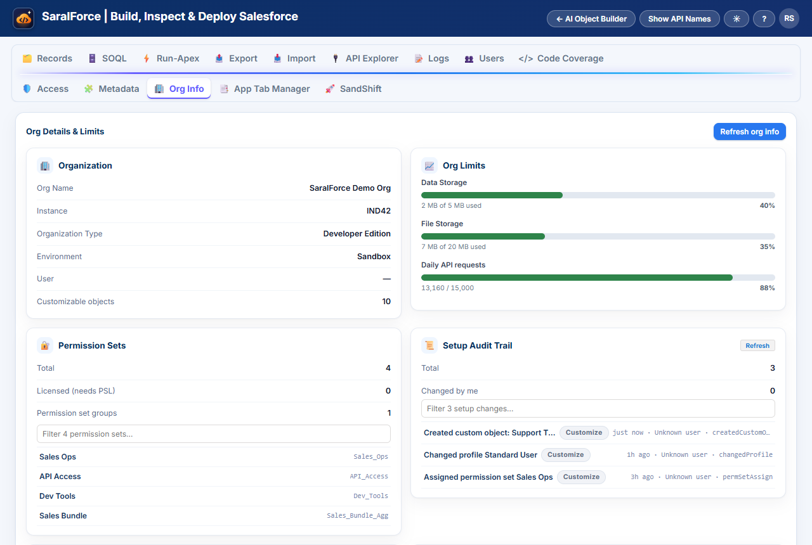

Details → [docs/FEATURES.md#14-org-info-](docs/FEATURES.md#14-org-info-)

### App Tab Manager

- ✏️ **Choose an app** from a searchable picker, or pin the exact one by URL or Id.
- **Add, reorder and remove** tabs on the app; newly created tabs are suggested.
- **Who can see a tab**: Default On / Off / Hidden for profiles and permission sets, or
  **Just make it visible to me**; **Check access** explains the App Launcher, with Fix it.

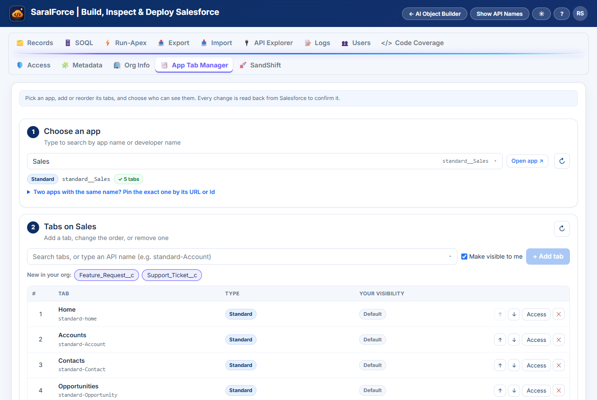

Details → [docs/FEATURES.md#15-app-tab-manager-%EF%B8%8F](docs/FEATURES.md#15-app-tab-manager-%EF%B8%8F)

### SandShift (release center)

Move changes between any two orgs you're logged into in this browser, either way. No extra login.

#### Compare

- Compares **every metadata type** both orgs have, with saved filters, date ranges, tabs for
  New / Changed / Only in target, who changed what and when, and a side-by-side diff.
- Dependency check with **Add missing**, deletes, ⇄ reverse deployment, ✨ release notes and CSV export.

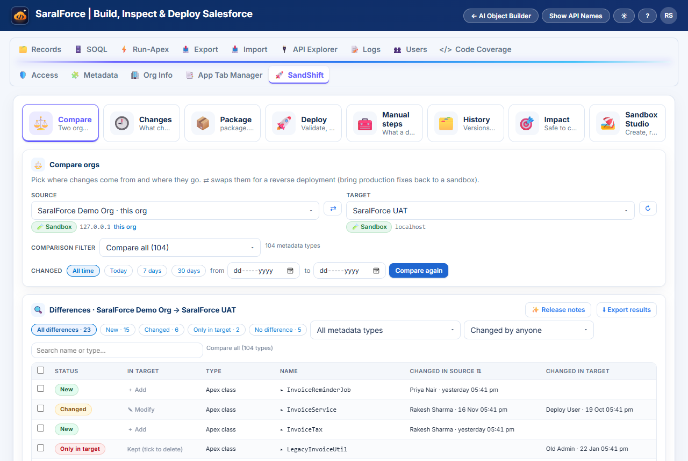

#### Changes

- Everything changed in an org since today, 7 or 30 days, the last release or a date: New,
  Updated or Deleted, by type and person, plus the Setup audit trail. **Add to package** in one click.

#### Package

- The same basket as Metadata → ＋ package.xml: add by name, paste or upload a package.xml or
  destructiveChanges.xml, and download the package or a source zip. Save drafts and load them later.

#### Validate and deploy

- **Validate** with live progress and a test level; **Quick deploy** after a pass; **Deploy now**
  in sandboxes.
- Errors grouped **by root cause** with Why and Fix, **＋ Add it to the deploy**, and ✨ **Ask AI**
  about the failures. Problem and overwrite checks run before every real deploy.

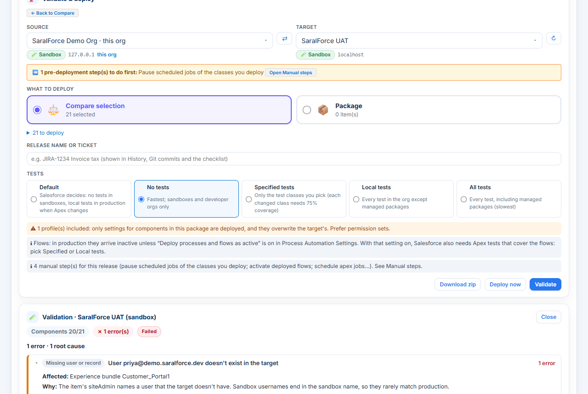

#### Manual steps

- A runbook of what a deploy doesn't do. SaralForce can activate flows, copy permission set
  assignments, group members and custom setting values, schedule Apex jobs and re-save tabs;
  the rest get Setup links. ✨ **Write the runbook**, Download checklist.

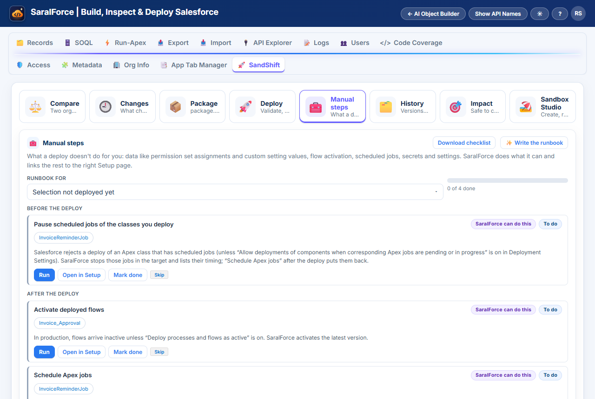

#### History and rollback

- Every validation and deploy, versioned per target org, with a **rollback point** saved first;
  **Roll back** (fully or partly), snapshots with drift compare and restore, check status of a
  lost deploy, and deploy a release to the next org.

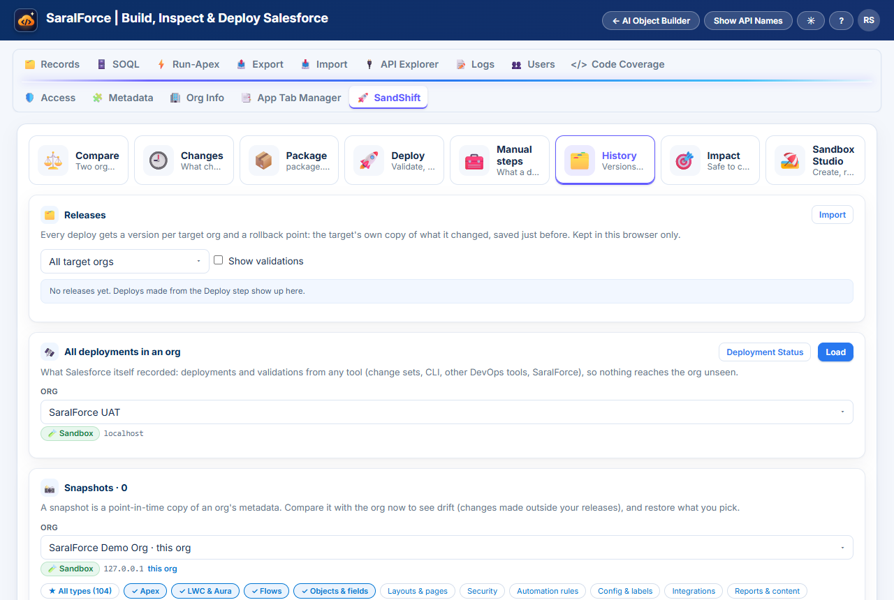

#### Impact

- What uses a field, object, class, flow or component, its data and active flows, with a
  safe-to-delete verdict and ✨ **Risk summary**. **Find unused** lists fields and objects nothing uses.

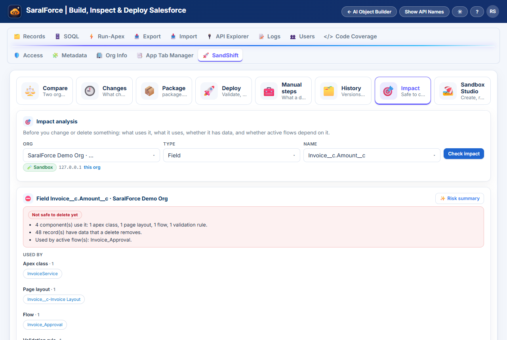

#### GitHub (optional)

- Connect a repository in Settings; **commit** releases and snapshots in Salesforce DX source
  format, use a branch as a source in Compare and Deploy, and open pull requests.

#### Sandbox Studio 🏖️ ✏️

- Run from production: every sandbox with license, status, copy progress, age and login URL;
  stale-sandbox banner; select several to copy URLs, refresh or compare.
- **＋ New**, **⧉ Clone**, **↻ Refresh** (with 💾 **Back up first**), Activate or Discard a
  refresh, and 🗑 Delete, each confirmed by typing the name.
- **💾 Backups** of metadata and data with restore; ✅ **Post-refresh steps** for email,
  scheduled jobs, outbound flows, integrations and who can log in.

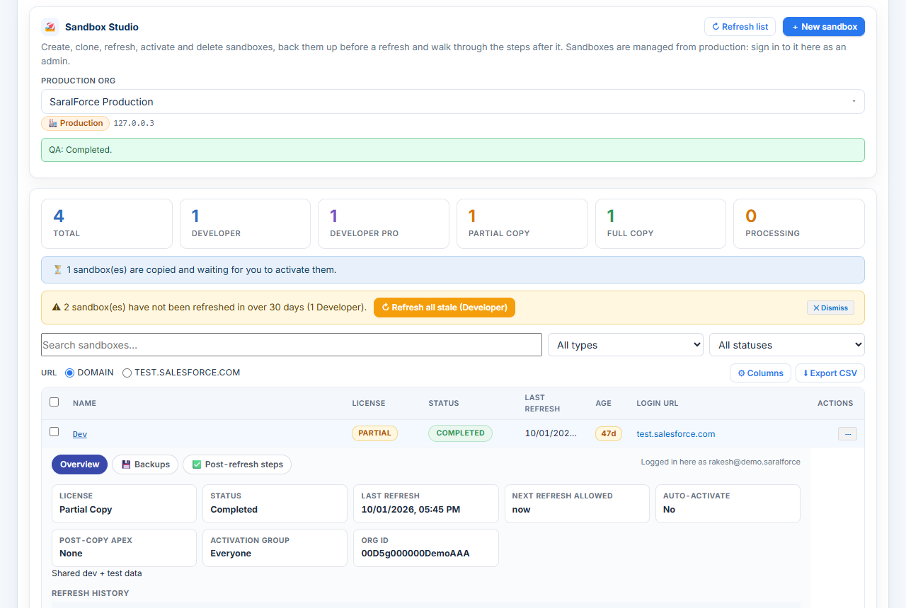

Details → [docs/FEATURES.md#16-sandshift-release-center-%EF%B8%8F-](docs/FEATURES.md#16-sandshift-release-center-%EF%B8%8F-) ·
[Sandbox Studio](docs/FEATURES.md#161-sandbox-studio-%EF%B8%8F-%EF%B8%8F)

### Settings & AI providers

- **Providers**: **Free (test)**, OpenAI, Anthropic Claude, Google Gemini, OpenRouter and any
  OpenAI-compatible endpoint. Paste a key, pick a model (**Refresh list**), **Save settings**,
  **Test connection**. Changes apply to open panels without a reload.
- **Free (test)**: no key and no model to pick. Tries LLM7, then Pollinations, then Cehpoint,
  falling back automatically on errors, timeouts and rate limits; **Test connection** shows which
  answered. For testing only: prompts go to those third-party services.
- **AI usage**: a small note after every ✨ request with tokens and time; **? → AI usage** lists
  every call of the session with its exact input and output, plus today and all-time totals.
- **AI is optional**; preferences for the celebration animation and opening the Inspector in a new tab.

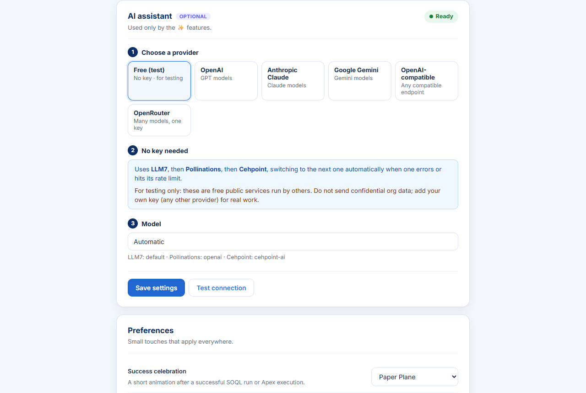

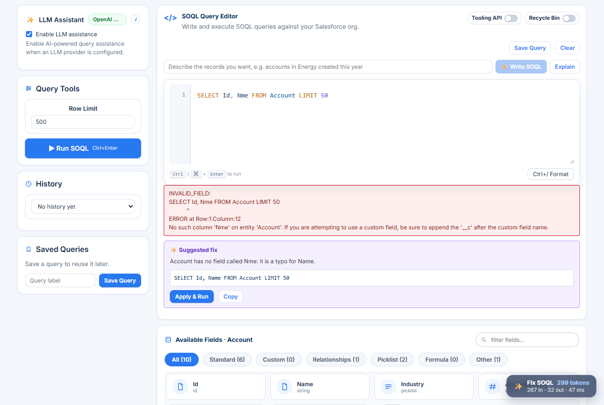

Details → [docs/FEATURES.md#17-settings--ai-providers](docs/FEATURES.md#17-settings--ai-providers)

### Safety, privacy and limits

- **Your data stays yours**: no accounts, analytics or tracking; org data goes to an AI provider
  only when you press ✨, and then only what that feature needs (your text plus schema, log
  excerpts, errors or metadata summaries). Free (test) uses public third-party services.
- **Kept in your browser**: AI keys and the GitHub token in extension storage; SandShift history,
  snapshots and Sandbox Studio backups (which can hold record data) in IndexedDB until you delete them.
- **Confirmations** before destructive or account-level actions; **AI never acts on its own**:
  every result is shown first.
- **Managed package items** are read-only; **your Salesforce permissions apply**; Apex classes and
  triggers can't be created directly in production (Salesforce rule).
- **Quick "can I…?" answers**: a question-by-question list of what SaralForce can do and where.

Details → [docs/FEATURES.md#18-safety-privacy-and-limits](docs/FEATURES.md#18-safety-privacy-and-limits) ·
[Quick "can I…?" answers](docs/FEATURES.md#19-quick-can-i-answers)

## Installation

### From the store

- **Google Chrome**: [SaralForce on the Chrome Web Store](https://chromewebstore.google.com/detail/saralforce/fgapgjgejookdgliokajnbfkabkifclg)
- **Microsoft Edge**: [SaralForce on Microsoft Edge Add-ons](https://microsoftedge.microsoft.com/addons/detail/saralforce/nabomjoibaaoialocfpphgcmfldjmeik)

Then open any Salesforce page and click the floating SaralForce button.

### Load unpacked (developers)

Prerequisites: Chrome or Edge, Node.js with npm, and a Salesforce org (System Administrator
for setup and deploy features).

1. **Clone or download this repository**
2. **Install dependencies** (to get React):
   ```bash
   cd sf-object-creator
   npm install
   npm run copy-react
   ```
3. **Load the extension**:
   - Open `chrome://extensions/` (or `edge://extensions/`)
   - Enable **Developer mode**
   - Click **Load unpacked** and select the `addon` folder of this project
4. **Set up AI (optional)**:
   - Open Settings (**?** → Open Settings, or the extension's options page)
   - Pick **Free (test)** to try the ✨ features with no key, or pick a provider, paste your API
     key and pick a model
   - Click **Save settings** (the browser asks for access to the AI hosts) then **Test connection**
5. **Start**: open your Salesforce org, click the SaralForce button, and pick a tool or describe
   an object in the AI Object Builder.

## Usage Examples

### Example 1: Payment Transactions
```
I want an object that captures payment transaction data including amount, status, payment method, and reference numbers
```

**AI Output**: Creates a `Payment_Transaction__c` object with fields:
- Amount (Currency)
- Status (Picklist: Pending, Completed, Failed, Refunded)
- Payment Method (Picklist: Credit Card, Debit Card, Bank Transfer, PayPal, Other)
- Reference Number (Text, External ID)
- Transaction Date (DateTime)

### Example 2: Support Tickets with Relationships
```
Create a customer support ticket object that relates to Accounts and Contacts, with priority levels and assignment tracking
```

**AI Output**: Creates a `Support_Ticket__c` object with Lookup fields to Account and Contact, plus Priority picklist, Status picklist, and assignment fields.

### Example 3: Refinement
After the initial proposal, you can say (or use ✨ **Ask AI** in Plan mode):
```
Add a field for the resolution notes and make the priority field required
```

The AI will update the proposal accordingly.

### Example 4: Write SOQL from plain English
In SOQL, tick *Enable LLM assistance* and ask:
```
open cases for gold accounts created this month, newest first
```

The AI writes the query with your org's real field names and picklist values; **Use & Run**.

### Example 5: A validation rule without formulas
In Metadata → Validation Rules → ✨ **Use AI**:
```
close date can't be in the past when stage is Closed Won
```

## Supported Field Types

| Type | Description |
|------|-------------|
| Text | Short text (up to 255 chars) |
| Text Area | Multi-line text |
| Text Area (Long) | Very long text content |
| Text Area (Rich) | Formatted text with images and links |
| Text (Encrypted) | Sensitive text shown masked (up to 175 chars) |
| Number | Numeric values |
| Currency | Monetary amounts |
| Percent | Percentage values |
| Date | Date only |
| Date/Time | Date and time |
| Time | Time of day without a date |
| Checkbox | Boolean true/false |
| Picklist | Single select from values |
| Picklist (Multi-Select) | Multiple select from values |
| Email | Email addresses |
| Phone | Phone numbers |
| URL | Web links |
| Lookup | Relationship to another object |
| Master-Detail | Required relationship to another object |
| Formula | Calculated from other fields (Text, Number, Currency, Percent, Date, Date/Time, Time or Checkbox result) |
| Roll-Up Summary | COUNT, SUM, MIN or MAX of child records (master side of a Master-Detail) |
| Auto Number | System-generated sequence, e.g. INV-{0000} |
| Geolocation | Latitude and longitude |

Picklists can also use an org **global value set**, or depend on a **controlling field**
(picklist or checkbox) with a value-by-value dependency matrix. Any field can turn on
**history tracking** and **help text**.

## What's New

### Next release
- **Sandbox Studio** (SandShift) — create, clone, refresh, activate or discard and delete sandboxes from
  production; back up metadata and data before a refresh and restore it; post-refresh steps for email,
  scheduled jobs, outbound flows, integrations and who can log in
- **Org Handbook** (Metadata) — an onboarding view of any org: a checklist, business processes and the life
  of a record, every flow in plain words with a simple diagram, Ask the org, What's new and people; kept in
  this browser, exported whole as HTML or Markdown
- **Free (test) AI provider** — try the ✨ features with no key; requests go to free public endpoints (LLM7,
  Pollinations, Cehpoint) with automatic fallback. For testing only
- **AI settings apply without a reload** — saving a provider, key or model takes effect in open panels at once

### v2.3.3
- **Movable launcher** — drag the SaralForce button anywhere on the page; it stays there on every
  Salesforce tab, and right-click puts it back
- **Code Coverage** — a row's **Run** runs the test classes that cover it; **Run All Tests** asks first
  (with a production warning); every class is loaded; a stuck or failed run is reported
- **Object Builder** — Cancel always ends a deploy; editing an existing object leaves its tab visibility
  and app alone; "Choose profiles" with none ticked is blocked; guest profiles are left out of "All profiles"
- **Access compare** — unique production / sandbox column names, warnings when data is cut off, sections
  an org can't read are marked instead of showing false differences, "Same as left" by API name
- **Fixes from a full code review** — metadata XML values checked, exact profile matching, Apex checks
  that no longer miss code after `//` in strings, layouts keep their columns, and more
- New headline: **SaralForce | Build, Inspect & Deploy Salesforce**

### v2.3.2
- **Access → Sharing settings** — Setup's Sharing Settings page in two orgs side by side: org-wide defaults
  (internal and external), other sharing settings, sharing rules, sharing sets and restriction / scoping rules,
  object by object, with what differs in plain words
- **Access → Compare** — two sides, each in its own org; compare profiles & permission sets, users (effective
  access, with where it comes from) or roles, public groups & queues; readable differences and more sections
- **Find unused** (SandShift → Impact) — custom fields and objects nothing uses, ready for the delete list
- **SandShift** — ask AI about a failed deploy; upload a package.xml
- The wolf mascot on empty screens and a lighter watermark; progress bars scroll into view; Code Coverage next to
  Users; per-tab tips no longer pop up; dark-mode dropdown fixes

### v2.3.1
- **SandShift** — the Release tab has a new name
- **Session expiry handled** — an expired session is renewed from your new login automatically; when you are
  logged out, a banner offers **Reconnect** and **Log in to Salesforce**, then **Reload this tool**
- **Smarter code checks** — fewer false alarms on valid Apex (stripInaccessible, assertEquals chains,
  queryWithBinds, sub-queries, mocks without asserts, lightning/toast); **Check with Salesforce anyway** when
  a check looks wrong; edits only flag problems they add
- **SandShift fixes** — Deploy opens on the screen you came from with a Back link, "What to deploy" cards,
  rollback warning only in rollback mode, green progress bar, no double polling, an interrupted deploy no longer
  locks the screen
- **Plain-language errors** in Records (validation, required field, duplicate, not found, session, access)
- Larger sub-tab icons; store description updated

### v2.3.0
- **Release** keeps its work across minimize/maximize, shows compare progress in %, retrieves both orgs at once,
  resumes a running deploy and explains a queued one
- **Reliable code deploys** — AI-written and template Apex, triggers, Visualforce, LWC and Aura pass a
  known-mistake check, then **Check compile** (Salesforce compiles the whole draft, saves nothing) and an
  all-or-nothing **Deploy** as one package; ✨ Fix with AI sends every compile error and rechecks
- **SandShift** (new tab, release center) — compare any two orgs you're logged into and deploy either way:
  side-by-side diffs, dependency check with **Add missing**, deletes, a change tracker by date and
  person, package.xml / destructiveChanges.xml, **Validate**, **Quick deploy**, **Deploy now** and
  Cancel; ✨ AI release notes and ✨ Explain failures
- **Release history & rollback** — versions per target org, a rollback point saved before every
  deploy, one-click **Roll back**, org snapshots with drift compare and restore, export/import
- **Manual steps** — a runbook of what a deploy doesn't do: SaralForce activates flows, copies
  permission set assignments, group members and custom setting values, schedules Apex jobs,
  re-saves tabs and runs post-deploy scripts; guided Setup links for the rest; ✨ AI runbook
- **Impact analysis** — what uses a field, class or flow, its data and active flows, with a
  safe-to-delete verdict and ✨ risk summary
- **GitHub** (optional) — commit releases and snapshots in source format, compare and deploy
  from a branch
- **Changes** shows New / Updated / Deleted (deletes from source tracking and the audit trail), dates in
  the org user's time zone; **Integrations** in Compare (named and external credentials, external data
  sources, remote sites, CSP sites, external services, connected and external client apps)
- **Release safety** — problem checks before deploy, overwrite warning when the target changed, release
  name/ticket and who deployed, drafts, deploy a release to the next org, partial rollback, check status of
  a lost deploy, all deployments in an org, pull requests from a release, deletes before or after
- **Log profiler** — Logs → ⏱ Profile: timeline, slowest methods, queries and DML in loops,
  limits, ✨ speed-up tips
- **Deploy fixes** — Apex and trigger templates and AI use `WITH USER_MODE` (current API versions
  reject `WITH SECURITY_ENFORCED`), with a one-click **Quick fix** for drafts that still have it;
  LWC and Aura bundles create their base file first (fixes "No base file for markup://…")
- **Compare** uses a searchable picker (the list now shows in full screen too)
- **Edit an existing object** — search objects by name, edit existing fields (label, description,
  help text, required, length, new picklist values), and **Undo / Redo** every plan change

### v2.2.0
- **New objects show up in the App Launcher** — after deploying, the Object Builder checks
  what Salesforce really applies for you (tab, tab setting, object access) and repairs it,
  re-saving the tab so the App Launcher picks it up; a ✓/✕ checklist with **Fix it** and a
  one-click **Save in Setup** fallback, also under App Tab Manager → Who can see a tab
- **Show in app** — pick a Lightning app in the builder and the new tab is added to its nav
  bar; new fields go on every page layout of the object
- **Field suggestions** — formulas, validation rules, list views and compact layouts suggest
  field API names as you type; a formula that uses a missing field is caught before deploy
- **Clearer Object Builder** — picklist values and formulas shown under each field type,
  Controlled by Parent explained, deploy jumps to its progress, chats named after the object
- **Redesigned Settings** — says up front that AI is optional; provider tiles, Get a key
  links, Ready / Not set up status and Remove key
- **Simpler App Tab Manager** — searchable app and tab pickers, one Add button, the tabs
  table right below, and a clear "Who can see a tab" step
- **AI usage you can see** — after every ✨ request a ghost note shows the tokens used
  (input, output, total) and time for a few seconds; **? → AI usage** lists every call of the
  session with its exact input and output, plus today and all-time totals. Text stays in
  memory only; the note can be turned off in Settings

### v2.1.0
- **Run Apex** — one call per run returns that run's own debug log (no trace flag);
  a **Limits** tab shows CPU, SOQL, DML and heap used; **Go to line** for errors (also
  when running highlighted lines); Shift+Tab un-indents; a double Ctrl+Enter runs once
- **Test runner** — live progress per test class, **Abort**, passed / failed / skipped per
  method with messages and stack traces, **✨ Explain failure**, and a **Lines** view of
  covered and uncovered lines
- **API Explorer** — REST, Composite, Tooling and SOAP (Partner, Metadata, Apex) calls
  with presets, clickable response links, headers, timing and history
- **Related records & field history** — Show All Data gains **Related** (parents and
  child lists with counts; click through and come back) and **History** (timeline)
- **Object Builder 2.0** — 7 new field types (formula, roll-up summary, auto number,
  geolocation, time, rich text, encrypted text), global and dependent picklists, history
  tracking, validation rules, list views and compact layouts, ⚙ field details, ✨ Ask AI
  in Plan, field access for chosen profiles or a new permission set, and **Edit an
  existing object**
- **Data quality** — Metadata → Schema → Data quality profiles a record sample (fill
  rate, repeated values, outliers, inactive picklist values, duplicates) with an ✨ AI review

### v2.0.0
- **Readable metadata details** — every item opens on an Overview instead of plain text:
  Apex shows its declaration (sharing, interfaces, annotations), counters (SOQL, DML,
  callouts) and a method list that jumps to the line; triggers show the object, which of
  the 7 events they run on and the handler they call; Visualforce shows its controller,
  components and merge fields; source views have line numbers
- **LWC and Aura bundles** — an Overview of where the component can be used (exposed,
  targets), public properties, Apex and wire calls, child components and events (Aura:
  interfaces, attributes, handlers, controller actions), plus a bundle file tree
- **Validation rules you can read and edit** — highlighted formula with the fields and
  functions it uses, a preview of the error the user sees, an Active switch, and in-place
  editing; **✨ Use AI** writes or changes the formula, message and error field from plain
  English using the object's real fields (also in New → Validation Rule)
- **Build LWCs with AI** — in New → LWC, describe the component and **✨ Write component**
  creates the HTML, JS, CSS, targets and any Apex controller it needs, using your org's real
  fields; the bundle is checked (template root, class name, Apex imports, no innerHTML) and
  opens in the editor for review. In the editor, **✨ Ask AI to change** edits any draft
  (Apex, trigger, page, LWC, Aura), **✨ Fix with AI** sends a failed deploy's error back,
  and **Undo AI change** restores the previous files. Nothing deploys until you press Deploy
- **Edit existing components, by hand or with AI** — open any Apex class, trigger,
  Visualforce page, LWC or Aura component in Metadata and press **✏️ Edit**: its files from the
  org open in the editor (marked EDITING), where **✨ Ask AI to change** and **Undo AI change**
  work as for new drafts. **Check compile** (Apex, triggers, pages) asks Salesforce to compile
  without saving; **💾 Save to org** shows what changes, asks first, warns if someone changed it
  in the org meanwhile, and on a compile error **✨ Fix with AI** sends the line-numbered error
  back. Unsaved edits stay in this browser. Apex, triggers and pages save through a
  MetadataContainer (like the Developer Console); LWC and Aura files update in place.
  Components from managed packages stay read-only
  > **Note:** Apex classes and triggers can only be changed this way in **sandboxes and
  > developer orgs**. Salesforce blocks it in production; deploy those changes with a change
  > set, VS Code or the Metadata API.
- **Build Apex, triggers, pages and Aura with AI too** — the same **✨ Build with AI** box in
  New → Apex class (writes the class plus a test class), Trigger (a thin trigger plus a
  handler class), Visualforce page (and a controller only if needed) and Aura component
  (markup, controller, helper, CSS and any Apex). Each draft is checked before you see it
  (class names, balanced braces, trigger name and object, page and component roots) and
  deploys in the right order: handlers and controllers first, test classes after their class
- **Real starter templates** — new LWCs start from a basic card, record details, record
  form, Apex data table with search (controller and test class included) or a quick action;
  Aura has card, record details, quick action and Apex data table
- **Custom Metadata Types** in Metadata — browse types with all their fields and record
  values, **edit records in place** and save them together, delete records, add a record,
  create a new type with fields (Metadata API), download records as CSV and add types or
  single records to package.xml
- **Tool tabs in two rows** — data and code tools on top, admin tools below, divided by a
  glass line, instead of one row that scrolls sideways
- **Access → Approvals** — your approval inbox (direct and through queues), every pending
  request in the org, and what you submitted; Approve or Reject with an optional comment
  (asks first), and submit a recently viewed record for approval. Access now has a small
  menu: Compare · Risky access · Approvals
- **Metadata → New** — create an Apex class (9 templates: service, batch, queueable,
  schedulable, invocable, REST, controller, test …), a trigger with an optional handler
  class, a Visualforce page, a Lightning Web Component (name, label, isExposed, CSS/SVG,
  searchable targets, API version, description), an Aura component, a flow (autolaunched,
  record-triggered, screen or scheduled, saved as a draft) or a validation rule. **Create**
  opens the generated files in an editor (drafts are kept in this browser); **Deploy**
  creates them through the Tooling API, cleaning up if a step fails. Apex can only be
  created in sandboxes and developer orgs
- **Flows are readable** — a flow now shows what starts it, then every step in order with
  plain-words details and where each decision branch goes; switch versions, see the outline
  or the raw metadata
- **Metadata look refreshed** — kind chips with icons and counts, coloured icon tiles in
  lists, a clearer detail header and empty states
- **Users search as you type** — the list narrows on every keystroke and the org is
  searched after a short pause, so users beyond the first page are found too; Esc clears
- **Access tab** — compare 2 to 5 profiles, permission sets or groups side by side
  (system, object, tab and app permissions, "only differences", CSV download), and a
  **Risky Access Audit** listing active users with powerful permissions such as Modify All
  Data or Author Apex and what grants them, with an optional AI summary
- **Users: assign and remove permission sets and groups** (removal asks first), plus an
  **Access Check** sub-tab that answers "why can this user see this object, field or
  system permission?" by listing every profile, set and group that grants it. Cloning a
  user now copies permission set group assignments correctly
- **Metadata tab** — browse Apex classes, triggers, Visualforce, LWC, Aura, flows (with
  versions) and validation rules; read the source, open it in Setup, and **✨ Explain** it in
  plain words. **Schema** shows every field with type details, picklists and formulas,
  who can read or edit a field, where a custom field is used, and a relationship diagram.
  Add items to a **package.xml** basket, or download an object's schema as JSON
- **SOQL autocomplete** — suggestions appear as you type in the SOQL editor: objects after
  FROM, fields, relationship paths such as `Owner.Profile.Name` (any depth Salesforce allows),
  child relationships inside sub-queries, `FIELDS(ALL)` and clause keywords. Arrow keys
  to move, Enter or Tab to accept, Esc to close
- **Write SOQL from plain English** — with LLM assistance enabled, describe the records you
  want and get a query built from your org's real field names and picklist values; review
  it, then Use or Use & Run. **Explain** describes the query in the editor in plain words
- **All fetched rows reachable** — SOQL results page 300 rows at a time instead of stopping
  at 300; when a query has more than 20,000 rows, **Fetch more rows** continues from where
  it stopped, with honest "x of y" totals
- **Show API Names button tells the truth** — it switches to Hide API Names only after the
  names actually appear on the page; on non-record pages, failures or after Salesforce
  re-renders the page it stays (or returns to) Show API Names
- **Guided tours** — a short welcome tour the first time the panel opens, a one-tip
  intro the first time each tool is opened, an Object Builder tour, a setup tour on the
  Settings page after install, and a "what is new" summary after updates. A small tip
  points out the launcher on your first Salesforce page. Replay any of them from the new
  **?** button in the header (Take the tour, Tour this tool, What is new, Open Settings, and Help, which opens
  the GitHub issues page).
  Keyboard friendly (arrows, Esc) and shown only once each
- **Theme follows your device** — new installs start in light or dark to match the OS
  setting (no dark flash on load); the header button cycles System, Light and Dark.
  The design itself is unchanged
- **Lighter package** — about 10% smaller: unused and overridden CSS rules removed
  (verified pixel-identical on every tab in both themes), PNGs recompressed losslessly,
  logo design sources and the hosted farewell page left out of the store zip, dead
  helper functions removed
- **Bulk API 2.0 import fixed** — CSV upload now uses `PUT` and jobs close with
  `UploadComplete`, as the Bulk 2.0 API requires; Bulk requests share the panel's
  session handling, retries and cancellation
- **Faster Data API import** — records go through sObject Collections, up to 200 per call
  (was one call per row), with live progress, a Stop button, success/failed result files
  and real record ids for upserts
- **Spreadsheet formula protection** — CSV exports (on by default in Export, always for
  quick downloads) prefix cells that start with `=`, `+`, `-` or `@` with an apostrophe;
  plain numbers are kept
- **Smarter AI** — malformed JSON replies get one automatic repair attempt; debug-log AI
  analysis keeps the errors near the end of long logs instead of only the first 12k
  characters; AI requests can be cancelled
- **Settings in extension storage** — AI provider settings and preferences move from page
  storage to `chrome.storage` (migrated automatically) and stay in sync across open panels
- **Under the hood** — the Inspector is split into one module per tool with a tab
  registry and accessible tabs; the Object Builder's Metadata XML/SOAP code lives in
  `addon/builder/`; ~700 lines of dead code removed; one shared Salesforce API client
  (`addon/core/sf-client.js`) with retries for reads, timeouts and cancellation

### v1.7.0
- **Security hardening** — the Salesforce session is no longer written into the Salesforce
  page's storage or posted across frames; the panel looks it up itself and only runs when
  framed by a page of the same org. Panel and page messages are origin-checked, and only
  the panel page is web-accessible
- **AI Object Builder deploys you can trust** — failed deploys are reported as failures
  (never "Deployment Successful"), with Resume deploy after a partial failure and a working
  Retry with new name; AutoNumber name fields deploy; Required applies to all supported
  field types; unknown field types, bad API names and invalid sharing models are caught
  before deploying; sturdier parsing of AI replies; object creation uses `createMetadata`
- **AI providers fixed for current models** — Claude, OpenAI and Gemini requests no longer
  send sampling settings that newer models reject, leave room for model reasoning, and read
  the answer correctly; Claude streaming works; Gemini keys moved out of the URL
- **Model picker** — type any model ID or pick from suggestions, and load the models your
  key can use with **Refresh list**; switching provider resets the model; OpenRouter works
  without a base URL; plain-http AI endpoints are refused (except localhost)
- **Inspector fixes** — Bulk exports with several result chunks no longer repeat header
  rows; import result counts handle multi-line fields; Reset Password, Freeze, job aborts
  and log/trace-flag deletes ask for confirmation; large SOQL results stay responsive and
  say honestly when they are truncated; default LIMIT is placed correctly before OFFSET /
  FOR VIEW; LIKE searches escape `%` and `_`; long polls stop when you leave a tab
- **Developer tooling** — ESLint, unit tests (`npm test`), `npm run package` for store zips,
  and GitHub Actions CI

### v1.6.0
- **New SaralForce brand mark** — the orange cloud `</>` logo replaces the old blue one
  everywhere: toolbar icons (16 / 32 / 48 / 128), the panel header logo, the floating
  page button and the sidebar header, with hand-tuned 16px and 32px vector variants so
  the mark stays crisp at small sizes
- **Record context from Setup and classic pages** — opening a record from
  `/lightning/setup/...` (including the wrapped `address=` targets and Object Manager
  detail pages) or a classic `/{keyprefix}/{id}` URL now hands the record to the panel;
  when only the Id is known it is carried as-is and the object is resolved from the
  Id prefix, so deep links land on the right record
- **Tooling API fallback** — API calls that miss on a standard endpoint
  (`INVALID_TYPE`, `NOT_FOUND`, `INVALID_ENDPOINT`) automatically retry on the Tooling
  API, cached per object, so tooling-only metadata (and layouts exposed only there)
  resolves without a manual switch
- **Farewell page rebuilt** — `goodbye.html` is fully self-contained (inline CSS, SVG
  and JS) with the rising-petals effect merged in; petals pause while the tab is hidden
  and are switched off entirely under `prefers-reduced-motion`. The separate
  `goodbye.js` file is gone
- **Smaller permission footprint** — the `storage` permission is removed (the extension
  keeps settings in `localStorage` and never used it), so the only permission left is
  `cookies`

### v1.5.0
- **Advanced Export rebuilt as a data-management workbench** — three columns (setup,
  query + preview, advanced options) shared with the new Import tab; Data API or
  Bulk API 2.0; SOQL Query and Object Export modes; a searchable object selector with
  recent objects; and a syntax-highlighted editor with line numbers, autocomplete,
  validate, format and query examples
- **Field Explorer** — fields grouped as Standard / Custom / Relationship / Formula /
  Picklist with a search box, click to insert at the caret (duplicates are refused),
  plus insert-all
- **Real paginated preview** — client-side sortable columns, "load more from server"
  paging that follows the Data API records, honest loading / empty / error states, and
  downloads of CSV, Excel (a built-in writer, no new dependency) or JSON honouring your
  delimiter, quoting, encoding, date format, null value, line-ending and header options
- **Bulk 2.0 job tracking for queries** — job ID, state, records processed, copyable
  job ID, cancel, and result retrieval that follows Sforce-Locator pagination
- **Advanced Import** — Insert / Update / Upsert / Delete (plus Hard Delete where the
  org supports it, behind an explicit confirmation), run through Data API batches or
  Bulk API 2.0 ingest (create → upload → close → poll → result files), with the success,
  failed and unprocessed records downloadable straight from Salesforce
- **CSV in, safely** — drag-and-drop or pasted CSV parsed properly (quotes, escaped
  quotes, multiline cells), an interactive mapping table with auto-suggested matches,
  searchable field dropdowns, required / read-only / duplicate / unmapped / invalid
  indicators, relationship and external-ID references, and saveable mapping templates
- **Validate Data before you run** — client-side checks for the operation you picked
  (missing Id on update, missing external ID on upsert, missing required fields, bad
  picklist values, malformed ids, dates and numbers) with a results table and a
  downloadable error CSV; the summary is always labelled as preliminary because
  Salesforce decides the final outcome
- **Client-side duplicate check** — pick a column and surface repeated values before you
  import; it is a plain value check and says so, since it is not Salesforce duplicate rules
- **Import job history and destructive-action guards** — every run recorded per org and
  user, double-submit prevention, no automatic retry after a failure, and delete-style
  operations confirmed before anything is sent
- **Shared workbench layout polish** — the setup / work / options columns use one spacing
  and typography scale: field boxes are spaced instead of touching, labels stay aligned
  with their controls, the save-name row fits inside its card, disabled buttons are still
  visible, and the Import action bar spans the layout as its own final row (a fixed bottom
  bar below 860px) so the Run button is always reachable
- **Nothing overlaps while scrolling** — below 1240px the setup column no longer stays
  pinned while the full-width options row scrolls underneath it, so the Export / Import
  Setup card can never cover Advanced Options or Recent Objects; the sticky setup and
  options columns are kept only in the wide three-column layout, where each stays inside
  its own column

### v1.4.23
- **App Tab Manager** (replaces App Tabs) — a full three-step manager for Lightning
  app navigation: searchable app picker with an info card (name, developer name,
  type, status) plus the exact-app pin by App Manager URL / record Id; a tab picker
  with org suggestions and a "recently created" highlight; and a Current App Tabs
  table with type, your profile's visibility, position and per-row actions
- **Reorder & remove** — move tabs up/down and remove tabs with confirmation, each
  change written as a full read-modify-write round-trip and verified by re-reading
  the app metadata; console workspace mappings and standard-app `standard__` writes
  are handled automatically
- **Honest visibility controls** — Visible to me (your profile), plus batch writes
  to selected profiles and permission sets (Default On / Default Off / Hidden) —
  the places Salesforce actually stores tab visibility, with clear guidance when
  object-level access is also required
- **AI Object Builder handoff** — after a successful object deploy, "Add to
  Lightning App" preselects the new object's tab in the App Tab Manager; nothing is
  written until you pick the app and approve

### v1.4.22
- **Optional AI network access** — AI provider hosts moved out of the install-time
  permissions; SaralForce now asks permission to reach the chosen provider (OpenAI,
  Claude, Gemini, OpenRouter or a custom endpoint) when you click Save Settings
- **Records: "No object selected" screen** — pages that are neither a record nor a
  list view show a getting-started empty state with a manual object loader, instead
  of silently re-opening the last explored object
- **Users: Freeze / Unfreeze** — toggle a user's login access in one click from the
  Quick Actions (below Clone User); the frozen state also shows in Account & Login
- Hardened record-page detection so non-Salesforce URLs can never fake a record context

### v1.4.21
- **Chrome Web Store readiness** — packaged goodbye page moved to an external script
  (MV3 CSP compliance), manifest description refreshed
- SaralForce logo on the Settings page links to the project site
- Footer credit links to the ErBhajanMandali site
- README: Edge Add-ons "Get it now" badge (Chrome coming soon) plus new screenshots for
  Enhance Prompt, Records and Code Coverage

### v1.4.20
- **OpenRouter provider** — pick OpenRouter in Settings with its own API-key/base-URL
  placeholders and vendor/model ID guidance; shares the OpenAI-compatible adapter
- SOQL LLM chip no longer overlaps the editor title in light theme
- README refreshed with current screenshots for Object Builder, SOQL, Run Apex,
  Debug Logs and Users

### v1.4.19
- **Users tab rebuilt** — auto-loaded user list with profile/role filters, full detail
  tabs (Permission Sets, Groups, Profiles, Roles, Settings), recent Login IP, **Reset
  Password**, and a two-step **Clone User** wizard (select components → review → create)
- **Run-Apex polish** — compact Log Level / Timeout controls, iOS-style **Use AI**
  pre-check switch, Execute + Execute Highlighted moved to the sidebar, header trimmed
- **SOQL quality-of-life** — click any result ID to Show All Data, plain `N row(s)`
  counts, light-theme legibility fixes across the panel

### v1.4.17
- **Records** rewritten with View / Read-only / Edit modes and summary header
- **SOQL M3** two-column redesign with field explorer, Tooling API and Recycle Bin
  toggles, and terminal-style field tools
- CloudFlow light theme with Inter typography across the inspector
- Gemini model lineup refresh; last-page restore with a reload guard

### v1.4.15
- Inspector-in-new-tab option, Show All Data button, full Apex log viewer
- Code Coverage tab, Experience-site login fix, aggregate LIMIT guard
- Editor success celebrations (plane / confetti / thor / spidey)

## Architecture

```
sf-object-creator/
├── addon/                     # The shipped extension (no build step; React is the global h)
│   ├── manifest.json          # Manifest V3
│   ├── background.js          # Service worker (session lookup, LLM proxy)
│   ├── button.js/css          # Content script: launcher button, Show API Names
│   ├── inspector.js           # Salesforce API layer and apiVersion
│   ├── inspector-tools.js     # Inspector tab registry
│   ├── inspector/
│   │   ├── inspector-panel.js # Inspector shell
│   │   ├── tabs/              # One module per tool (Records, SOQL, SandShift, …)
│   │   └── shared/            # Shared panel components and session state
│   ├── core/                  # Logic without UI: sf-client, bulk, deploy, access, handbook, …
│   ├── builder/               # AI Object Builder Metadata XML / SOAP and plan editor
│   ├── object-creator.html/js # Main page: builder chat, preview, inspector shell
│   ├── options.html/js        # Settings and AI providers
│   ├── llm/
│   │   ├── llm-service.js     # Provider registry, defaults and fallback models
│   │   ├── free-test.js       # Free (test) provider with endpoint fallback
│   │   ├── openai.js · claude.js · gemini.js · openai-compatible.js
│   │   └── stream.js
│   ├── prompts/system-prompt.js
│   ├── ui/                    # Tours, confirmations, AI usage, GitHub settings
│   └── styles/slds/           # Salesforce Lightning Design System CSS
├── scripts/                   # Dev server with mock org, packaging, screenshots
├── test/unit/                 # node --test unit tests
├── docs/                      # FEATURES.md, screenshots
└── package.json
```

## Security

- AI provider keys and the optional GitHub token are stored in the extension's own storage
  (`chrome.storage.local`, never in Salesforce pages) and sent only to the AI provider you
  configured and to `api.github.com`
- The extension communicates directly with Salesforce APIs using your existing session; there
  is no SaralForce server in between
- AI requests carry only what the feature needs (your description, the relevant schema or code,
  or error text); record data stays in your org unless you paste it in
- The **Free (test)** provider sends prompts to third-party public endpoints (LLM7, Pollinations,
  Cehpoint): use it to try features, and your own key for real org data
- Deploys, deletes, rollbacks and data changes ask first and name the target org; AI-written code
  must pass a lint and a Salesforce compile check before it can be deployed
- Signs in with OAuth2 PKCE or your existing Salesforce session cookie

## Permissions

- `cookies`: read Salesforce session cookies for API authentication
- `storage`: keep settings, AI keys and the GitHub connection in the extension's storage
- Host permissions for Salesforce domains (`*.salesforce.com`, `*.force.com`,
  `*.visualforce.com` and the other Salesforce hosts), needed to run the panel on your pages
- **Optional** host permission for `https://*/*`: requested only when you click **Save settings**
  for an AI provider (just that provider's hosts; all three for Free (test), or your custom
  OpenAI-compatible URL) or connect GitHub (`api.github.com`). Without it, everything except AI
  and GitHub calls works

## Development

```bash
# Install dependencies and copy React into addon/
npm install
npm run copy-react

# Lint and unit tests
npm run lint
npm test

# Preview the panel against a mock org
npm run dev

# Regenerate the README screenshots (run while npm run dev is up)
npm run readme-shots

# Build the store zip
npm run package
```

To load the extension: open `chrome://extensions/`, enable Developer mode, click
**Load unpacked** and select the `addon/` folder.

## License

MIT License — see `LICENSE`. Includes third-party open-source code; see
`THIRD-PARTY-NOTICES.md` for attributions.

SaralForce is an independent project by Bhajan Mandali and is not affiliated with,
sponsored, or endorsed by Salesforce, Inc.
