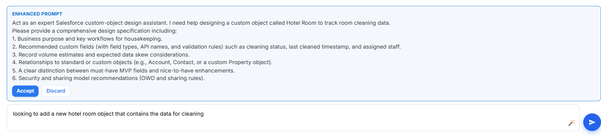
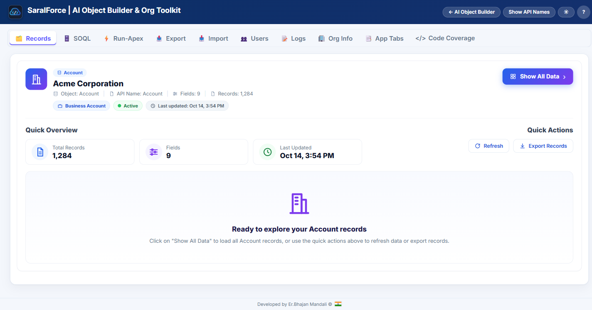
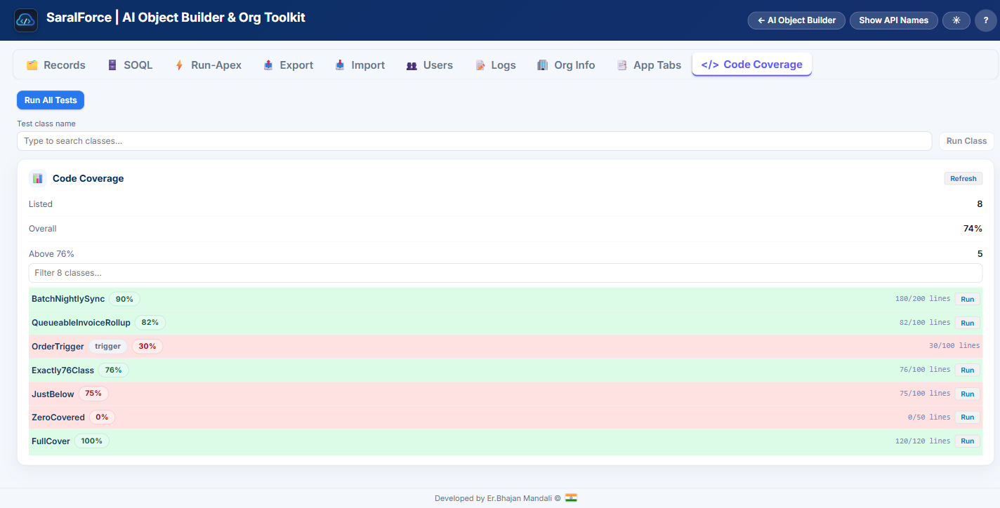

# SaralForce — AI Salesforce Inspector, Admin & Developer Toolkit

<p align="center">
  <a href="https://microsoftedge.microsoft.com/addons/detail/saralforce/nabomjoibaaoialocfpphgcmfldjmeik"></a>
  
</p>

A Chrome browser extension that pairs an LLM (Large Language Models) object designer with a
full Salesforce inspector — build custom objects from natural language, then run SOQL, execute
Apex, manage users, read debug logs, export data to CSV and inspect your org without leaving
the page.

## FAQ

**What is SaralForce?**
SaralForce is a free, AI-powered Salesforce inspector extension for Microsoft Edge and Google Chrome. A sidebar on every Salesforce page gives you an AI object builder, a SOQL runner with CSV data export, an Apex executor, a debug-log analyzer, user management, org info and code coverage.

**How is SaralForce different from other Salesforce inspector tools?**
It covers the classic inspector workflows — SOQL queries, CSV data export, record lookup, user management — and adds an AI layer on top: build custom objects from plain-English descriptions, get failing SOQL auto-repaired, understand debug logs in plain English, and turn rough ideas into structured design briefs with Enhance Prompt.

**Is SaralForce free? Does it send my data anywhere?**
The extension is free. AI features use your own provider API key (OpenAI, Anthropic Claude, Google Gemini, OpenRouter, or any OpenAI-compatible endpoint), stored only in your browser. Org data is sent to your chosen AI provider only when you explicitly ask. No accounts, no analytics, no tracking.

**Do I need an AI API key to use it?**
No. Everything except the AI features works with just your Salesforce login — SOQL, CSV data export and import, Apex execution, debug logs, users, org info and code coverage.

**Which browsers are supported?**
Microsoft Edge (install from the Edge Add-ons store) and Google Chrome (Chrome Web Store version coming soon; or load the `addon` folder as an unpacked extension).

## Features

> **Full feature guide:** see [docs/FEATURES.md](docs/FEATURES.md) for every tool, what it can view and change, and step-by-step details.

- **Natural Language Object Design**: Describe what data you want to capture in plain English, and the AI proposes a complete Salesforce object with fields
- **Multi-LLM Support**: Works with OpenAI, Anthropic Claude, Google Gemini, OpenRouter, and any OpenAI-compatible API (OpenCodeZen, etc.)
- **Interactive Refinement**: Chat with the AI to modify the proposal - add fields, change types, adjust properties
- **Visual Preview (Plan / Build)**: Review the schema before deploying — labels, API names, types, required flags — then refine inline in Plan mode
- **One-Click Deploy**: Creates the custom object and all fields directly in your Salesforce org via the Tooling API, with profile tab-visibility targets
- **Relationship Fields**: AI suggests Lookup and Master-Detail relationships when appropriate
- **Field Permissions**: Configurable field-level security during deployment
- **AI Query Repair**: SOQL errors are explained and auto-fixed by the LLM with one-click apply
- **AI Log Analysis**: Debug logs get a plain-English verdict plus per-log AI chat
- **Inspector Tools**: Records browser (View / Read / Edit modes), SOQL runner, Apex executor, CSV export/import, user management with clone wizard, debug-log viewer with AI analysis, org info, app-tab assignment, code coverage

## AI Object Builder

Describe what you want in plain English and the AI proposes the complete object — labels,
API names, data types, required flags, picklist values, and Lookup/Master-Detail
relationships. Keep chatting to refine it ("add a field for resolution notes", "make
Priority required") and deploy when the visual preview looks right.

**✨ Enhance Prompt** turns a rough one-liner into a structured design brief before you
send it: business purpose, key fields and their data types, expected record volume,
relationships to standard objects, must-have vs. nice-to-have features, and security and
sharing recommendations — with **Accept** / **Discard** controls.



After the proposal arrives, the **Object Preview** opens in **Plan** mode: edit the object
label, API name, sharing model and every field inline, pick deployment-target profiles,
then switch to **Build** to lock the plan and deploy.

Plan mode also has **⚙ field details** for every type (formula, roll-up, dependencies…),
**Object settings** (history, reports, activities, search, feeds, validation rules, list
views, compact layout), **✨ Ask AI** to change the plan in plain English, and a **Field
access** choice: your profile, the tab-visibility profiles, or a new permission set
assigned to you. **✎ Edit an existing object** loads a custom object from the org so you
can add fields, rules and list views beside the ones it already has.


## Inspector Tools

Open the **Inspector** from the header (or the sidebar button) to reach every tool below.
The last opened tab and scroll position are restored the next time you open the panel.

### SOQL

A two-column workspace: LLM assistant chip, row limit, run button, query history and
saved queries on the left; the syntax-highlighted editor, colour-coded field explorer
(with category pills) and results table on the right — no horizontal scrolling.
Tooling API and Recycle Bin toggles switch the backing API per query. Click any **ID**
cell in the results to open **Show All Data** for that record.

When Salesforce rejects a query, the extension asks the LLM for a **✨ Suggested fix**:
a plain-English explanation of what went wrong plus the corrected query, with
**Apply & Run** and **Copy** buttons.


### Run Apex

Execute anonymous Apex with a terminal-style editor: line numbers, syntax highlighting,
**Quick Templates**, and saved/recent script chips. Choose the **Log Level** and
**Timeout**, then **Execute** (or Ctrl+Enter) — or select a snippet and **Execute
Highlighted**. Toggle **Use AI** to pre-check code before each run; compile errors get a
suggested fix you can apply in one click. After a run, the **Execution Results** panel
shows the debug log with event filters, a Debug-Only view, and the raw trace.


### Debug Logs

- Load recent `ApexLog` rows for any user or Apex class in a chosen time window, with
  trace-flag management built in.
- **⚡ AI Quick Analysis (Plain English)** — a one-click verdict per log rendered as four
  cards: *What happened*, *Errors*, *Debug highlights*, *Next step*. Results are cached
  per log ID, so clicking **Analyzed** again shows the saved result without another AI
  call; **Re-run** forces a fresh call when you want one.
- **💬 Ask AI** — a per-log chat for drilling into any line of the trace.
- Search across every loaded log body, view/download individual logs, or delete them
  (single or bulk) straight from the panel.


### Users

Search and filter the org's users by profile or role, then select one to inspect:
full detail tabs (**Details**, **Permission Sets**, **Groups**, **Profiles**, **Roles**,
**Settings**), recent **Login IP** addresses, and quick actions — **Login As**, **Enable
Logs** (30-minute debug trace), **Copy Id**, and **View in Salesforce**. Community users
get an **Experience-site login** picker when live sites exist.

**Clone User** walks through a two-step wizard — pick the source user and the components
to copy (permission sets, groups, role), review the summary, then create the new user
and its assignments. **Reset Password** sends the standard Salesforce password-reset
email via the User password API.


### Records, Export & Import

- **Records** — open any record in View, Read-only or Edit mode with a field summary,
  related-record lookups, Show-All-Data popup, and CSV export of the current layout.
- **Advanced Export** — a three-column workbench: object + Field Explorer on the left
  (Standard / Custom / Relationship / Formula groups, click to insert into the query),
  a syntax-highlighted SOQL editor with line numbers, autocomplete, validate and format
  in the middle, and API, output-format and CSV-writing options on the right. Preview
  pages through real results with client-side sorting, then download CSV, Excel or JSON
  or copy the query. Saved exports and run history persist per org and user.
- **Advanced Import** — the matching three-column layout for Insert, Update, Upsert and
  Delete: drag-and-drop or pasted CSV, interactive field mapping with auto-suggestion
  and saveable templates, client-side Validate Data with a downloadable error CSV, and
  runs through the Data API in batches or Bulk API 2.0 ingest with live job tracking and
  the success, failed and unprocessed result files pulled straight from Salesforce.



### Org Info, App Tabs & Code Coverage

- **Org Info** — org identity, storage and API limits, recent setup-audit events and
  login history; an optional AI hygiene audit summarises what to fix first.
- **App Tabs** — assign custom tabs to console applications so new objects show up where
  your users work.
- **Code Coverage** — per-class coverage from `ApexCodeCoverageAggregate`, test-class
  filtering, and a one-click test run with freshness polling.



## Installation

### Quick install (Microsoft Edge)

Install directly from the Edge Add-ons store:
**[SaralForce on Microsoft Edge](https://microsoftedge.microsoft.com/addons/detail/saralforce/nabomjoibaaoialocfpphgcmfldjmeik)**.

The Chrome Web Store version is coming soon.

### Prerequisites

- Google Chrome (v88+) or Microsoft Edge browser
- Node.js with npm (for React dependencies)
- A Salesforce org where you have System Administrator permissions
- An API key from at least one LLM provider

### Setup

1. **Clone or download this repository**

2. **Install dependencies** (to get React):
   ```bash
   cd sf-object-creator
   npm install
   npm run copy-react
   ```

3. **Load the extension in Chrome**:
   - Open `chrome://extensions/`
   - Enable **Developer mode** (toggle in top right)
   - Click **Load unpacked**
   - Select the `addon` subdirectory of this project

4. **Configure your LLM provider**:
   - Click the extension icon on any Salesforce page
   - Click **Options** (or open `options.html` from the extension)
   - Select your LLM provider (OpenAI, Claude, Gemini, OpenRouter, or OpenAI-compatible)
   - Enter your API key
   - Select a model
   - Click **Save Settings** then **Test Connection**

5. **Start creating objects**:
   - Navigate to your Salesforce org
   - Click the extension icon
   - Click **SaralForce** sidebar button
   - Describe the object you want to create!

## Usage Examples

### Example 1: Payment Transactions
```
I want an object that captures payment transaction data including amount, status, payment method, and reference numbers
```

**AI Output**: Creates a `Payment_Transaction__c` object with fields:
- Amount (Currency)
- Status (Picklist: Pending, Completed, Failed, Refunded)
- Payment Method (Picklist: Credit Card, Debit Card, Bank Transfer, PayPal, Other)
- Reference Number (Text, External ID)
- Transaction Date (DateTime)

### Example 2: Support Tickets with Relationships
```
Create a customer support ticket object that relates to Accounts and Contacts, with priority levels and assignment tracking
```

**AI Output**: Creates a `Support_Ticket__c` object with Lookup fields to Account and Contact, plus Priority picklist, Status picklist, and assignment fields.

### Example 3: Refinement
After the initial proposal, you can say:
```
Add a field for the resolution notes and make the priority field required
```

The AI will update the proposal accordingly.

## Supported Field Types

| Type | Description |
|------|-------------|
| Text | Short text (up to 255 chars) |
| Text Area | Multi-line text |
| Text Area (Long) | Very long text content |
| Number | Numeric values |
| Currency | Monetary amounts |
| Percent | Percentage values |
| Date | Date only |
| Date/Time | Date and time |
| Checkbox | Boolean true/false |
| Picklist | Single select from values |
| Picklist (Multi-Select) | Multiple select from values |
| Email | Email addresses |
| Phone | Phone numbers |
| URL | Web links |
| Lookup | Relationship to another object |
| Master-Detail | Required relationship to another object |
| Formula | Calculated from other fields (Text, Number, Currency, Percent, Date, Date/Time, Time or Checkbox result) |
| Roll-Up Summary | COUNT, SUM, MIN or MAX of child records (master side of a Master-Detail) |
| Auto Number | System-generated sequence, e.g. INV-{0000} |
| Geolocation | Latitude and longitude |
| Time | Time of day without a date |
| Text Area (Rich) | Formatted text with images and links |
| Text (Encrypted) | Sensitive text shown masked (up to 175 chars) |

Picklists can also use an org **global value set**, or depend on a **controlling field**
(picklist or checkbox) with a value-by-value dependency matrix. Any field can turn on
**history tracking** and **help text**.

## LLM Provider Configuration

OpenAI, Anthropic Claude, Google Gemini, OpenRouter, and any OpenAI-compatible endpoint
(OpenCodeZen, etc.) are supported. One configuration drives every AI feature —
the object-builder chat, Enhance Prompt, SOQL query repair, Apex pre-check, and
debug-log analysis.

- **API Key**: your provider's key (stored only in your browser's local storage)
- **Base URL**: only needed for OpenAI-compatible endpoints and OpenRouter
- **Models**: the Options page always lists the currently supported models

## What's New

### v2.1.0
- **Run Apex** — one call per run returns that run's own debug log (no trace flag);
  a **Limits** tab shows CPU, SOQL, DML and heap used; **Go to line** for errors (also
  when running highlighted lines); Shift+Tab un-indents; a double Ctrl+Enter runs once
- **Test runner** — live progress per test class, **Abort**, passed / failed / skipped per
  method with messages and stack traces, **✨ Explain failure**, and a **Lines** view of
  covered and uncovered lines
- **API Explorer** — REST, Composite, Tooling and SOAP (Partner, Metadata, Apex) calls
  with presets, clickable response links, headers, timing and history
- **Related records & field history** — Show All Data gains **Related** (parents and
  child lists with counts; click through and come back) and **History** (timeline)
- **Object Builder 2.0** — 7 new field types (formula, roll-up summary, auto number,
  geolocation, time, rich text, encrypted text), global and dependent picklists, history
  tracking, validation rules, list views and compact layouts, ⚙ field details, ✨ Ask AI
  in Plan, field access for chosen profiles or a new permission set, and **Edit an
  existing object**
- **Data quality** — Metadata → Schema → Data quality profiles a record sample (fill
  rate, repeated values, outliers, inactive picklist values, duplicates) with an ✨ AI review

### v2.0.0
- **Readable metadata details** — every item opens on an Overview instead of plain text:
  Apex shows its declaration (sharing, interfaces, annotations), counters (SOQL, DML,
  callouts) and a method list that jumps to the line; triggers show the object, which of
  the 7 events they run on and the handler they call; Visualforce shows its controller,
  components and merge fields; source views have line numbers
- **LWC and Aura bundles** — an Overview of where the component can be used (exposed,
  targets), public properties, Apex and wire calls, child components and events (Aura:
  interfaces, attributes, handlers, controller actions), plus a bundle file tree
- **Validation rules you can read and edit** — highlighted formula with the fields and
  functions it uses, a preview of the error the user sees, an Active switch, and in-place
  editing; **✨ Use AI** writes or changes the formula, message and error field from plain
  English using the object's real fields (also in New → Validation Rule)
- **Build LWCs with AI** — in New → LWC, describe the component and **✨ Write component**
  creates the HTML, JS, CSS, targets and any Apex controller it needs, using your org's real
  fields; the bundle is checked (template root, class name, Apex imports, no innerHTML) and
  opens in the editor for review. In the editor, **✨ Ask AI to change** edits any draft
  (Apex, trigger, page, LWC, Aura), **✨ Fix with AI** sends a failed deploy's error back,
  and **Undo AI change** restores the previous files. Nothing deploys until you press Deploy
- **Edit existing components, by hand or with AI** — open any Apex class, trigger,
  Visualforce page, LWC or Aura component in Metadata and press **✏️ Edit**: its files from the
  org open in the editor (marked EDITING), where **✨ Ask AI to change** and **Undo AI change**
  work as for new drafts. **Check compile** (Apex, triggers, pages) asks Salesforce to compile
  without saving; **💾 Save to org** shows what changes, asks first, warns if someone changed it
  in the org meanwhile, and on a compile error **✨ Fix with AI** sends the line-numbered error
  back. Unsaved edits stay in this browser. Apex, triggers and pages save through a
  MetadataContainer (like the Developer Console); LWC and Aura files update in place.
  Components from managed packages stay read-only
  > **Note:** Apex classes and triggers can only be changed this way in **sandboxes and
  > developer orgs**. Salesforce blocks it in production; deploy those changes with a change
  > set, VS Code or the Metadata API.
- **Build Apex, triggers, pages and Aura with AI too** — the same **✨ Build with AI** box in
  New → Apex class (writes the class plus a test class), Trigger (a thin trigger plus a
  handler class), Visualforce page (and a controller only if needed) and Aura component
  (markup, controller, helper, CSS and any Apex). Each draft is checked before you see it
  (class names, balanced braces, trigger name and object, page and component roots) and
  deploys in the right order: handlers and controllers first, test classes after their class
- **Real starter templates** — new LWCs start from a basic card, record details, record
  form, Apex data table with search (controller and test class included) or a quick action;
  Aura has card, record details, quick action and Apex data table
- **Custom Metadata Types** in Metadata — browse types with all their fields and record
  values, **edit records in place** and save them together, delete records, add a record,
  create a new type with fields (Metadata API), download records as CSV and add types or
  single records to package.xml
- **Tool tabs in two rows** — data and code tools on top, admin tools below, divided by a
  glass line, instead of one row that scrolls sideways
- **Access → Approvals** — your approval inbox (direct and through queues), every pending
  request in the org, and what you submitted; Approve or Reject with an optional comment
  (asks first), and submit a recently viewed record for approval. Access now has a small
  menu: Compare · Risky access · Approvals
- **Metadata → New** — create an Apex class (9 templates: service, batch, queueable,
  schedulable, invocable, REST, controller, test …), a trigger with an optional handler
  class, a Visualforce page, a Lightning Web Component (name, label, isExposed, CSS/SVG,
  searchable targets, API version, description), an Aura component, a flow (autolaunched,
  record-triggered, screen or scheduled, saved as a draft) or a validation rule. **Create**
  opens the generated files in an editor (drafts are kept in this browser); **Deploy**
  creates them through the Tooling API, cleaning up if a step fails. Apex can only be
  created in sandboxes and developer orgs
- **Flows are readable** — a flow now shows what starts it, then every step in order with
  plain-words details and where each decision branch goes; switch versions, see the outline
  or the raw metadata
- **Metadata look refreshed** — kind chips with icons and counts, coloured icon tiles in
  lists, a clearer detail header and empty states
- **Users search as you type** — the list narrows on every keystroke and the org is
  searched after a short pause, so users beyond the first page are found too; Esc clears
- **Access tab** — compare 2 to 5 profiles, permission sets or groups side by side
  (system, object, tab and app permissions, "only differences", CSV download), and a
  **Risky Access Audit** listing active users with powerful permissions such as Modify All
  Data or Author Apex and what grants them, with an optional AI summary
- **Users: assign and remove permission sets and groups** (removal asks first), plus an
  **Access Check** sub-tab that answers "why can this user see this object, field or
  system permission?" by listing every profile, set and group that grants it. Cloning a
  user now copies permission set group assignments correctly
- **Metadata tab** — browse Apex classes, triggers, Visualforce, LWC, Aura, flows (with
  versions) and validation rules; read the source, open it in Setup, and **✨ Explain** it in
  plain words. **Schema** shows every field with type details, picklists and formulas,
  who can read or edit a field, where a custom field is used, and a relationship diagram.
  Add items to a **package.xml** basket, or download an object's schema as JSON
- **SOQL autocomplete** — suggestions appear as you type in the SOQL editor: objects after
  FROM, fields, relationship paths such as `Owner.Profile.Name` (any depth Salesforce allows),
  child relationships inside sub-queries, `FIELDS(ALL)` and clause keywords. Arrow keys
  to move, Enter or Tab to accept, Esc to close
- **Write SOQL from plain English** — with LLM assistance enabled, describe the records you
  want and get a query built from your org's real field names and picklist values; review
  it, then Use or Use & Run. **Explain** describes the query in the editor in plain words
- **All fetched rows reachable** — SOQL results page 300 rows at a time instead of stopping
  at 300; when a query has more than 20,000 rows, **Fetch more rows** continues from where
  it stopped, with honest "x of y" totals
- **Show API Names button tells the truth** — it switches to Hide API Names only after the
  names actually appear on the page; on non-record pages, failures or after Salesforce
  re-renders the page it stays (or returns to) Show API Names
- **Guided tours** — a short welcome tour the first time the panel opens, a one-tip
  intro the first time each tool is opened, an Object Builder tour, a setup tour on the
  Settings page after install, and a "what is new" summary after updates. A small tip
  points out the launcher on your first Salesforce page. Replay any of them from the new
  **?** button in the header (Take the tour, Tour this tool, What is new, Open Settings, and Help, which opens
  the GitHub issues page).
  Keyboard friendly (arrows, Esc) and shown only once each
- **Theme follows your device** — new installs start in light or dark to match the OS
  setting (no dark flash on load); the header button cycles System, Light and Dark.
  The design itself is unchanged
- **Lighter package** — about 10% smaller: unused and overridden CSS rules removed
  (verified pixel-identical on every tab in both themes), PNGs recompressed losslessly,
  logo design sources and the hosted farewell page left out of the store zip, dead
  helper functions removed
- **Bulk API 2.0 import fixed** — CSV upload now uses `PUT` and jobs close with
  `UploadComplete`, as the Bulk 2.0 API requires; Bulk requests share the panel's
  session handling, retries and cancellation
- **Faster Data API import** — records go through sObject Collections, up to 200 per call
  (was one call per row), with live progress, a Stop button, success/failed result files
  and real record ids for upserts
- **Spreadsheet formula protection** — CSV exports (on by default in Export, always for
  quick downloads) prefix cells that start with `=`, `+`, `-` or `@` with an apostrophe;
  plain numbers are kept
- **Smarter AI** — malformed JSON replies get one automatic repair attempt; debug-log AI
  analysis keeps the errors near the end of long logs instead of only the first 12k
  characters; AI requests can be cancelled
- **Settings in extension storage** — AI provider settings and preferences move from page
  storage to `chrome.storage` (migrated automatically) and stay in sync across open panels
- **Under the hood** — the Inspector is split into one module per tool with a tab
  registry and accessible tabs; the Object Builder's Metadata XML/SOAP code lives in
  `addon/builder/`; ~700 lines of dead code removed; one shared Salesforce API client
  (`addon/core/sf-client.js`) with retries for reads, timeouts and cancellation

### v1.7.0
- **Security hardening** — the Salesforce session is no longer written into the Salesforce
  page's storage or posted across frames; the panel looks it up itself and only runs when
  framed by a page of the same org. Panel and page messages are origin-checked, and only
  the panel page is web-accessible
- **AI Object Builder deploys you can trust** — failed deploys are reported as failures
  (never "Deployment Successful"), with Resume deploy after a partial failure and a working
  Retry with new name; AutoNumber name fields deploy; Required applies to all supported
  field types; unknown field types, bad API names and invalid sharing models are caught
  before deploying; sturdier parsing of AI replies; object creation uses `createMetadata`
- **AI providers fixed for current models** — Claude, OpenAI and Gemini requests no longer
  send sampling settings that newer models reject, leave room for model reasoning, and read
  the answer correctly; Claude streaming works; Gemini keys moved out of the URL
- **Model picker** — type any model ID or pick from suggestions, and load the models your
  key can use with **Refresh list**; switching provider resets the model; OpenRouter works
  without a base URL; plain-http AI endpoints are refused (except localhost)
- **Inspector fixes** — Bulk exports with several result chunks no longer repeat header
  rows; import result counts handle multi-line fields; Reset Password, Freeze, job aborts
  and log/trace-flag deletes ask for confirmation; large SOQL results stay responsive and
  say honestly when they are truncated; default LIMIT is placed correctly before OFFSET /
  FOR VIEW; LIKE searches escape `%` and `_`; long polls stop when you leave a tab
- **Developer tooling** — ESLint, unit tests (`npm test`), `npm run package` for store zips,
  and GitHub Actions CI

### v1.6.0
- **New SaralForce brand mark** — the orange cloud `</>` logo replaces the old blue one
  everywhere: toolbar icons (16 / 32 / 48 / 128), the panel header logo, the floating
  page button and the sidebar header, with hand-tuned 16px and 32px vector variants so
  the mark stays crisp at small sizes
- **Record context from Setup and classic pages** — opening a record from
  `/lightning/setup/...` (including the wrapped `address=` targets and Object Manager
  detail pages) or a classic `/{keyprefix}/{id}` URL now hands the record to the panel;
  when only the Id is known it is carried as-is and the object is resolved from the
  Id prefix, so deep links land on the right record
- **Tooling API fallback** — API calls that miss on a standard endpoint
  (`INVALID_TYPE`, `NOT_FOUND`, `INVALID_ENDPOINT`) automatically retry on the Tooling
  API, cached per object, so tooling-only metadata (and layouts exposed only there)
  resolves without a manual switch
- **Farewell page rebuilt** — `goodbye.html` is fully self-contained (inline CSS, SVG
  and JS) with the rising-petals effect merged in; petals pause while the tab is hidden
  and are switched off entirely under `prefers-reduced-motion`. The separate
  `goodbye.js` file is gone
- **Smaller permission footprint** — the `storage` permission is removed (the extension
  keeps settings in `localStorage` and never used it), so the only permission left is
  `cookies`

### v1.5.0
- **Advanced Export rebuilt as a data-management workbench** — three columns (setup,
  query + preview, advanced options) shared with the new Import tab; Data API or
  Bulk API 2.0; SOQL Query and Object Export modes; a searchable object selector with
  recent objects; and a syntax-highlighted editor with line numbers, autocomplete,
  validate, format and query examples
- **Field Explorer** — fields grouped as Standard / Custom / Relationship / Formula /
  Picklist with a search box, click to insert at the caret (duplicates are refused),
  plus insert-all
- **Real paginated preview** — client-side sortable columns, "load more from server"
  paging that follows the Data API records, honest loading / empty / error states, and
  downloads of CSV, Excel (a built-in writer, no new dependency) or JSON honouring your
  delimiter, quoting, encoding, date format, null value, line-ending and header options
- **Bulk 2.0 job tracking for queries** — job ID, state, records processed, copyable
  job ID, cancel, and result retrieval that follows Sforce-Locator pagination
- **Advanced Import** — Insert / Update / Upsert / Delete (plus Hard Delete where the
  org supports it, behind an explicit confirmation), run through Data API batches or
  Bulk API 2.0 ingest (create → upload → close → poll → result files), with the success,
  failed and unprocessed records downloadable straight from Salesforce
- **CSV in, safely** — drag-and-drop or pasted CSV parsed properly (quotes, escaped
  quotes, multiline cells), an interactive mapping table with auto-suggested matches,
  searchable field dropdowns, required / read-only / duplicate / unmapped / invalid
  indicators, relationship and external-ID references, and saveable mapping templates
- **Validate Data before you run** — client-side checks for the operation you picked
  (missing Id on update, missing external ID on upsert, missing required fields, bad
  picklist values, malformed ids, dates and numbers) with a results table and a
  downloadable error CSV; the summary is always labelled as preliminary because
  Salesforce decides the final outcome
- **Client-side duplicate check** — pick a column and surface repeated values before you
  import; it is a plain value check and says so, since it is not Salesforce duplicate rules
- **Import job history and destructive-action guards** — every run recorded per org and
  user, double-submit prevention, no automatic retry after a failure, and delete-style
  operations confirmed before anything is sent
- **Shared workbench layout polish** — the setup / work / options columns use one spacing
  and typography scale: field boxes are spaced instead of touching, labels stay aligned
  with their controls, the save-name row fits inside its card, disabled buttons are still
  visible, and the Import action bar spans the layout as its own final row (a fixed bottom
  bar below 860px) so the Run button is always reachable
- **Nothing overlaps while scrolling** — below 1240px the setup column no longer stays
  pinned while the full-width options row scrolls underneath it, so the Export / Import
  Setup card can never cover Advanced Options or Recent Objects; the sticky setup and
  options columns are kept only in the wide three-column layout, where each stays inside
  its own column

### v1.4.23
- **App Tab Manager** (replaces App Tabs) — a full three-step manager for Lightning
  app navigation: searchable app picker with an info card (name, developer name,
  type, status) plus the exact-app pin by App Manager URL / record Id; a tab picker
  with org suggestions and a "recently created" highlight; and a Current App Tabs
  table with type, your profile's visibility, position and per-row actions
- **Reorder & remove** — move tabs up/down and remove tabs with confirmation, each
  change written as a full read-modify-write round-trip and verified by re-reading
  the app metadata; console workspace mappings and standard-app `standard__` writes
  are handled automatically
- **Honest visibility controls** — Visible to me (your profile), plus batch writes
  to selected profiles and permission sets (Default On / Default Off / Hidden) —
  the places Salesforce actually stores tab visibility, with clear guidance when
  object-level access is also required
- **AI Object Builder handoff** — after a successful object deploy, "Add to
  Lightning App" preselects the new object's tab in the App Tab Manager; nothing is
  written until you pick the app and approve

### v1.4.22
- **Optional AI network access** — AI provider hosts moved out of the install-time
  permissions; SaralForce now asks permission to reach the chosen provider (OpenAI,
  Claude, Gemini, OpenRouter or a custom endpoint) when you click Save Settings
- **Records: "No object selected" screen** — pages that are neither a record nor a
  list view show a getting-started empty state with a manual object loader, instead
  of silently re-opening the last explored object
- **Users: Freeze / Unfreeze** — toggle a user's login access in one click from the
  Quick Actions (below Clone User); the frozen state also shows in Account & Login
- Hardened record-page detection so non-Salesforce URLs can never fake a record context

### v1.4.21
- **Chrome Web Store readiness** — packaged goodbye page moved to an external script
  (MV3 CSP compliance), manifest description refreshed
- SaralForce logo on the Settings page links to the project site
- Footer credit links to the ErBhajanMandali site
- README: Edge Add-ons "Get it now" badge (Chrome coming soon) plus new screenshots for
  Enhance Prompt, Records and Code Coverage

### v1.4.20
- **OpenRouter provider** — pick OpenRouter in Settings with its own API-key/base-URL
  placeholders and vendor/model ID guidance; shares the OpenAI-compatible adapter
- SOQL LLM chip no longer overlaps the editor title in light theme
- README refreshed with current screenshots for Object Builder, SOQL, Run Apex,
  Debug Logs and Users

### v1.4.19
- **Users tab rebuilt** — auto-loaded user list with profile/role filters, full detail
  tabs (Permission Sets, Groups, Profiles, Roles, Settings), recent Login IP, **Reset
  Password**, and a two-step **Clone User** wizard (select components → review → create)
- **Run-Apex polish** — compact Log Level / Timeout controls, iOS-style **Use AI**
  pre-check switch, Execute + Execute Highlighted moved to the sidebar, header trimmed
- **SOQL quality-of-life** — click any result ID to Show All Data, plain `N row(s)`
  counts, light-theme legibility fixes across the panel

### v1.4.17
- **Records** rewritten with View / Read-only / Edit modes and summary header
- **SOQL M3** two-column redesign with field explorer, Tooling API and Recycle Bin
  toggles, and terminal-style field tools
- CloudFlow light theme with Inter typography across the inspector
- Gemini model lineup refresh; last-page restore with a reload guard

### v1.4.15
- Inspector-in-new-tab option, Show All Data button, full Apex log viewer
- Code Coverage tab, Experience-site login fix, aggregate LIMIT guard
- Editor success celebrations (plane / confetti / thor / spidey)

## Architecture

```
sf-object-creator/
├── addon/
│   ├── manifest.json          # Chrome Extension Manifest V3
│   ├── background.js          # Service worker (session + LLM proxy)
│   ├── inspector.js           # Salesforce API layer (REST/SOAP)
│   ├── inspector-tools.js     # Inspector tabs (Records, SOQL, Run-Apex, Users, Logs, …)
│   ├── object-creator.html/js # Main feature page (chat, preview, inspector shell)
│   ├── options.html/js        # LLM provider settings
│   ├── button.js/css          # Content script (injected into SF pages)
│   ├── sf-time.js             # Shared time-zone helpers
│   ├── llm/
│   │   ├── llm-service.js     # Provider abstraction + config
│   │   ├── openai.js          # OpenAI adapter
│   │   ├── claude.js          # Anthropic Claude adapter
│   │   ├── gemini.js          # Google Gemini adapter
│   │   └── openai-compatible.js
│   ├── prompts/
│   │   └── system-prompt.js   # AI prompt engineering
│   └── styles/slds/           # Salesforce Lightning Design System CSS
└── package.json
```

## Security

- API keys are stored locally in your browser (`localStorage`) and never sent anywhere except the LLM provider you configured
- The extension communicates directly with Salesforce APIs using your existing session
- Only your natural language descriptions are sent to LLM providers - object/field data stays in your org unless you paste it into the chat
- Signs in with OAuth2 PKCE or your existing Salesforce session cookie

## Permissions

- `cookies`: Read Salesforce session cookies for API authentication
- Host permissions for Salesforce domains (needed to inject the inspector on your pages)
- **Optional** host permission for `https://*/*`: requested only when you save an AI
  provider in Settings — it covers the chosen AI endpoint (or a custom OpenAI-compatible
  URL). Without it, everything except AI calls works as before

## Development

```bash
# Install dependencies
npm install

# Copy React files to addon directory
npm run copy-react

# Load in Chrome
# 1. Open chrome://extensions/
# 2. Enable Developer mode
# 3. Click Load unpacked
# 4. Select the addon/ directory
```

## License

MIT License — see `LICENSE`. Includes third-party open-source code; see
`THIRD-PARTY-NOTICES.md` for attributions.

SaralForce is an independent project by Bhajan Mandali and is not affiliated with,
sponsored, or endorsed by Salesforce, Inc.
